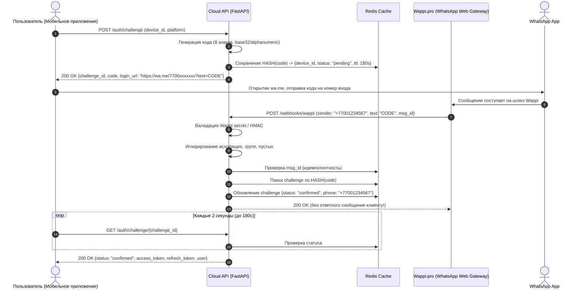

# POSCENTER Loyalty — Baseline Audit

**Дата аудита:** 29 сентября 2026 г.  
**Аудитор:** Senior Software Architect, Backend/Mobile Engineer & QA Auditor  
**Нормативный документ:** Техническое задание `TZ_loyalty_app_v1.1` («Мобильное приложение лояльности с интеграцией POSCENTER ONE»)  
**Рабочая директория аудита:** `/Users/nuras/Desktop/cashback-one`  
**Смежный контекст экосистемы:** `/Users/nuras/Desktop/poscenter app` (B2B SaaS-платформа для владельцев магазинов)

---

## 1. Executive Summary

### 1.1. Фактическое состояние проекта
Проект **POSCENTER Loyalty** в целевой рабочей директории `/Users/nuras/Desktop/cashback-one` находится в состоянии **Greenfield / Day-0**:
- Каталог `/Users/nuras/Desktop/cashback-one` полностью пуст (0 файлов, 0 байт кода, 0 конфигураций).
- Директория **не инициализирована как git-репозиторий** (`fatal: not a git repository`).
- Исходный код мобильного приложения (React Native / Expo), локального агента Windows (COM `V83.COMConnector`), облачного API (FastAPI) и админ-панели лояльности **полностью отсутствует**.

### 1.2. Анализ смежного репозитория экосистемы (`poscenter app`)
В ходе глубокого исследования файловой системы обнаружен смежный проект `/Users/nuras/Desktop/poscenter app`. Анализ его кодовой базы показал:
- Это отдельная B2B-система для владельцев магазинов («Ваш магазин в вашем смартфоне»: Next.js PWA `poscenter-next`, FastAPI бэкенд и PHP-шлюз CommerceML для синхронизации чеков, номенклатуры и остатков).
- В `poscenter app/backend/app/models/entities.py` (строки 729–762) присутствуют две предварительные сущности: `BonusCard` и `BonusMovement`. Однако они не связаны с клиентским приложением лояльности и используются исключительно для формирования аналитического отчета оборота бонусных карт для владельца торговой точки (`reports.py:665-678`).
- Ни одного из требуемых эндпоинтов ТЗ лояльности (`/auth/challenge`, `/webhooks/wappi`, `/me/cards`, `/agent/sync/cards` и др.) в `poscenter app` **нет**.
- Архитектура авторизации WhatsApp в `poscenter app` построена по прямой схеме отправки SMS/WhatsApp-кода сервером клиенту через Wappi, тогда как ТЗ `TZ_loyalty_app_v1.1` категорически требует **обратную схему** (App генерирует challenge $\rightarrow$ клиент пишет код в WhatsApp $\rightarrow$ входящий вебхук Wappi активирует сессию) для исключения спам-блокировок и расходов.

### 1.3. Степень соответствия ТЗ `TZ_loyalty_app_v1.1`
- **Фактическая готовность Stage 1 (MVP):** **0%**.
- **Фактическая готовность Stage 0 (Исследование 1С ONE):** **0%** (метаданные бонусной подсистемы реальной базы ONE не исследованы, COM-адаптер не написан).

### 1.4. Главные блокеры (P0 / P1)
1. **[P0] Отсутствие репозитория и кодовой базы проекта:** рабочая папка пуста.
2. **[P0] Невыполненный Stage 0:** точные имена объектов метаданных конфигурации POSCENTER ONE (справочник карт, реквизиты телефона/штрихкода/баланса, регистры накопления бонусов) неизвестны. Любая разработка без реальной структуры 1С несёт критический риск переделки схемы данных.
3. **[P1] Отсутствие Windows-агента ONE:** нет службы чтения COM `V83.COMConnector` в режиме read-only.
4. **[P1] Отсутствие Backend API и модели данных:** нет таблиц multi-tenancy `businesses`, `agents`, `cards`, `user_cards`, `login_challenges`.
5. **[P1] Отсутствие обратной схемы авторизации через Wappi:** нет генерации challenge, валидации входящего вебхука и сопоставления номеров E.164.
6. **[P1] Отсутствие мобильного приложения:** нет кода Expo/React Native (экраны Wallet, QR-код карты, сканер, история операций, профиль).

---

## 2. Repository Structure

### 2.1. Целевой каталог проекта (`cashback-one`)
```text
/Users/nuras/Desktop/cashback-one/
└── (директория пуста, .git отсутствует)
```
- Количество файлов: **0**
- Git status: `fatal: not a git repository (or any of the parent directories): .git`
- Branch / HEAD: отсутствует.

### 2.2. Связанный контекст соседней системы (`poscenter app`)
Рядом на диске расположен существующий проект розничной B2B-аналитики:
```text
/Users/nuras/Desktop/poscenter app/
├── backend/                  # FastAPI (Python 3.11), SQLAlchemy 2.0, Alembic
│   ├── app/
│   │   ├── api/v1/           # admin, auth, dashboard, exchange, reports, sync
│   │   ├── models/entities.py# B2B модели (Tenant, Store, User, Sale, BonusCard draft)
│   │   └── services/         # sync, notifications, exchange
│   └── tests/                # 90 passed, 3 skipped (B2B тесты аналитики)
├── poscenter-next/           # Next.js 16 PWA (кабинет директора магазина)
├── integrations/1c-poscenter/# 1C BSL-модули и расширение обмена для ERP/УТ
├── src/Exchange/             # PHP-шлюз протокола CommerceML 2.x
└── docs/                     # Архитектурная документация B2B-платформы
```
*Вывод аудита:* `poscenter app` не является кодовой базой `cashback-one`, но может служить эталоном стандартов кодирования (FastAPI, Alembic, Strict Typing) для создания нового сервиса лояльности.

---

## 3. Actual Architecture

### 3.1. Архитектурная схема: Целевая (ТЗ) vs Фактическая (Код)

```
[ЦЕЛЕВАЯ АРХИТЕКТУРА ПО ТЗ v1.1]

POSCENTER ONE (1C 8.3)
   │
   ▼ (COM V83.COMConnector, read-only, опрос раз в 2 мин)
ONE Agent (Windows Service, Python / pywin32)
   │
   ▼ (HTTPS: /agent/sync/cards, /agent/sync/transactions, /agent/heartbeat)
Cloud API (FastAPI, Python) ◄─── Wappi.pro Webhook (обратный вход)
   │                                  ▲
   ├── PostgreSQL (Tenants, Mirror)   │ (wa.me отправка кода)
   ├── Redis (Challenges, Rate-limits)│
   │                                  │
   ├──────────────────────────────────┴──────┐
   ▼                                         ▼
Mobile App (React Native Expo)         Admin Panel (Web)
(Клиенты: кошелек, QR, история)         (Суперадмин, Менеджер бизнеса)
```

```
[ФАКТИЧЕСКОЕ СОСТОЯНИЕ В РЕПОЗИТОРИИ]

POSCENTER ONE (1C 8.3)           ──> [СТАТУС: ВНЕШНИЙ ОБЪЕКТ, МЕТАДАННЫЕ НЕ ИЗВЕСТНЫ]
ONE Agent (Windows Service)       ──> [СТАТУС: NOT IMPLEMENTED (0%)]
Cloud API (FastAPI)              ──> [СТАТУС: NOT IMPLEMENTED (0%)]
PostgreSQL / Redis               ──> [СТАТУС: NOT IMPLEMENTED (0%)]
Mobile App (React Native Expo)   ──> [СТАТУС: NOT IMPLEMENTED (0%)]
Admin Panel                      ──> [СТАТУС: NOT IMPLEMENTED (0%)]
Wappi Integration                ──> [СТАТУС: NOT IMPLEMENTED (0%)]
```

### 3.2. Проверка ключевого инварианта ТЗ
> **Ключевой принцип:** *POSCENTER ONE является единственным источником истины (Source of Truth) по балансу и операциям. Облако хранит зеркало данных. Мобильное приложение только читает. Выпуск карт и запись производятся в 1С (кассир).*

- **Фактический статус соблюдения принципа:** Ввиду отсутствия кода нарушений не зафиксировано, однако принцип должен быть строго заложен в спецификацию API:
  1. Бэкенд облака **не должен** иметь эндпоинтов начисления/списания бонусов со стороны мобильного приложения или админки.
  2. Баланс карты в БД облака вычисляется и обновляется исключительно на основании данных пакетов от агента (`/agent/sync/cards` и `/agent/sync/transactions`).
  3. Любые расхождения баланса разрешаются в пользу последней ревизии/снимка из 1С ONE.

---

## 4. Requirements Matrix (Stage 1 MVP)

| ID | Требование ТЗ | Статус | Evidence (Код / Файлы) | Примечания / Анализ |
|---|---|---|---|---|
| **ST0-01** | Подключение к ONE через COM `V83.COMConnector` | `NOT IMPLEMENTED` | `/Users/nuras/Desktop/cashback-one` (пусто) | Нет скрипта/обработки для COM-подключения к 1С |
| **ST0-02** | Read-only режим подключения к 1С | `NOT IMPLEMENTED` | `/Users/nuras/Desktop/cashback-one` | Запрет на запись в 1С на этапе 1 |
| **ST0-03** | Снятие метаданных справочника карт и регистров ONE | `NOT IMPLEMENTED` | `poscenter app/integrations/1c-poscenter/src/POSCenterDataAdapter.bsl` | В смежном репозитории есть съем метаданных товаров/продаж, но нет метаданных карт лояльности |
| **AGN-01** | Выгрузка карт (barcode, phone, full_name, balance, is_blocked, updated_at) | `NOT IMPLEMENTED` | Отсутствует | Нет DTO и логики выборки |
| **AGN-02** | Выгрузка движений бонусов (external_id, barcode, type, amount, datetime, receipt, store) | `NOT IMPLEMENTED` | Отсутствует | Нет выборки движений из регистров 1С |
| **AGN-03** | Инкрементальная синхронизация по дате изменения | `NOT IMPLEMENTED` | Отсутствует | Нет хранения локального watermark/revision |
| **AGN-04** | Полная перезагрузка по команде из админки | `NOT IMPLEMENTED` | Отсутствует | Нет polling/websocket приема управляющих команд агентом |
| **AGN-05** | Настраиваемый интервал опроса (дефолт 2 мин) | `NOT IMPLEMENTED` | Отсутствует | Нет планировщика агента |
| **AGN-06** | Heartbeat каждые 60 секунд (версия, last_sync, errors) | `NOT IMPLEMENTED` | Отсутствует | Нет фонового потока heartbeat |
| **AGN-07** | Локальная очередь при обрыве интернета и досылка без дублей | `NOT IMPLEMENTED` | Отсутствует | Нет локальной SQLite/файловой очереди агента |
| **AGN-08** | Запуск агента как службы Windows | `NOT IMPLEMENTED` | Отсутствует | Нет обвязки `win32serviceutil` |
| **AGN-09** | Файл конфигурации и ротация логов агента | `NOT IMPLEMENTED` | Отсутствует | Нет конфигурационного парсера |
| **AGN-10** | Минимизация данных (запрет передачи даты рождения, email) | `NOT IMPLEMENTED` | Отсутствует | Должно быть жестко зафиксировано в выборке COM |
| **AUT-01** | Обратная схема входа через WhatsApp (генерация challenge 8 знаков) | `NOT IMPLEMENTED` | Отсутствует | Нет эндпоинта `POST /auth/challenge` |
| **AUT-02** | Генерация deeplink `wa.me/<number>?text=<code>` | `NOT IMPLEMENTED` | Отсутствует | Нет генератора ссылок |
| **AUT-03** | Прием входящего вебхука Wappi `POST /webhooks/wappi` | `NOT IMPLEMENTED` | Отсутствует | В `poscenter app` есть исходящий Wappi клиент, но нет входящего вебхука обратной схемы |
| **AUT-04** | Валидация подписи/секрета вебхука Wappi | `NOT IMPLEMENTED` | Отсутствует | Критично для безопасности |
| **AUT-05** | Идемпотентность вебхука по message_id | `NOT IMPLEMENTED` | Отсутствует | Защита от повторной обработки |
| **AUT-06** | Игнорирование исходящих, групповых сообщений и чужих кодов | `NOT IMPLEMENTED` | Отсутствует | Правило фильтрации трафика Wappi |
| **AUT-07** | Хранение хэша кода, TTL 3 мин, привязка к device_id | `NOT IMPLEMENTED` | Отсутствует | Защита от перехвата challenge |
| **AUT-08** | Опрос статуса challenge клиентом (интервал 2 сек, тайм-аут 3 мин) | `NOT IMPLEMENTED` | Отсутствует | Нет эндпоинта `GET /auth/challenge/{id}` |
| **AUT-09** | Резервный вход по SMS OTP (6 цифр, 5 мин, макс 5 попыток) | `NOT IMPLEMENTED` | Отсутствует | Нет эндпоинтов `POST /auth/sms/*` |
| **AUT-10** | Нормализация телефонов к формату E.164 (+7700... и 8700... равны) | `NOT IMPLEMENTED` | `poscenter app/backend/app/core/security.py:clean_phone` | В смежном репозитории есть утилита очистки, но не в loyalty |
| **AUT-11** | Выдача токенов JWT access (15 мин) + refresh (30 дней) и отзыв | `NOT IMPLEMENTED` | Отсутствует | Нет схемы токенов для покупателей |
| **AUT-12** | Аутентификация агентов по персональному API-ключу (хэш, отзыв) | `NOT IMPLEMENTED` | Отсутствует | В `poscenter app` используется basic token `x_client_id/x_client_secret` |
| **CRD-01** | Автопривязка карты при совпадении подтвержденного телефона с ONE | `NOT IMPLEMENTED` | Отсутствует | Нет фонового или inline-матчинга при авторизации |
| **CRD-02** | Привязка карты по скану QR физического пластика | `NOT IMPLEMENTED` | Отсутствует | Нет эндпоинта `POST /me/cards/bind` |
| **CRD-03** | Защита: запрет привязки карты, если в ONE указан другой телефон | `NOT IMPLEMENTED` | Отсутствует | Критическая проверка анти-фрода |
| **CRD-04** | Инвариант владения: один barcode привязан строго к $\le 1$ пользователю | `NOT IMPLEMENTED` | Отсутствует | Требуется `UNIQUE(card_id)` в `user_cards` |
| **CRD-05** | Определение бизнеса по префиксу штрихкода (таблица префиксов) | `NOT IMPLEMENTED` | Отсутствует | Нет таблицы префиксов и логики парсинга |
| **CRD-06** | Ручной выбор бизнеса при отсутствии префикса штрихкода | `NOT IMPLEMENTED` | Отсутствует | Нет интерфейса выбора бизнеса |
| **API-01** | `GET /me/cards` (список карт и балансов) | `NOT IMPLEMENTED` | Отсутствует | Эндпоинт отсутствует |
| **API-02** | `DELETE /me/cards/{id}` (скрыть карту у пользователя) | `NOT IMPLEMENTED` | Отсутствует | Эндпоинт отсутствует |
| **API-03** | `GET /me/cards/{id}/transactions` (история с пагинацией) | `NOT IMPLEMENTED` | Отсутствует | Эндпоинт отсутствует |
| **API-04** | `POST /agent/sync/cards` (пакет карт от агента) | `NOT IMPLEMENTED` | Отсутствует | Эндпоинт отсутствует |
| **API-05** | `POST /agent/sync/transactions` (пакет движений) | `NOT IMPLEMENTED` | Отсутствует | Эндпоинт отсутствует |
| **API-06** | `POST /agent/heartbeat` (состояние агента) | `NOT IMPLEMENTED` | Отсутствует | Эндпоинт отсутствует |
| **MOB-01** | Мобильное приложение: React Native (Expo) + TypeScript | `NOT IMPLEMENTED` | Отсутствует | Нет каталога `mobile/` |
| **MOB-02** | Экран онбординга и согласия на обработку ПД | `NOT IMPLEMENTED` | Отсутствует | Нет UI экранов |
| **MOB-03** | Экран входа через WhatsApp (кнопка, показ кода, deeplink) | `NOT IMPLEMENTED` | Отсутствует | Нет UI экранов |
| **MOB-04** | Экран кошелька (Wallet) со списком карт, балансами и логотипами | `NOT IMPLEMENTED` | Отсутствует | Нет UI экранов |
| **MOB-05** | Экран карты: крупный QR 13 цифр, штрихкод, баланс, оффлайн-кэш | `NOT IMPLEMENTED` | Отсутствует | Нет UI экранов |
| **MOB-06** | Повышение яркости экрана при открытии QR карты | `NOT IMPLEMENTED` | Отсутствует | Требуется `expo-brightness` |
| **MOB-07** | История операций: бесконечная прокрутка, точка продаж, чек | `NOT IMPLEMENTED` | Отсутствует | Нет UI экранов |
| **MOB-08** | Сканирование QR карты камерой + ручной ввод штрихкода | `NOT IMPLEMENTED` | Отсутствует | Требуется `expo-camera` / `expo-barcode-scanner` |
| **MOB-09** | Локализация: русский и казахский языки (RU / KZ) | `NOT IMPLEMENTED` | Отсутствует | Нет словарей переводов |
| **MOB-10** | Поддержка темной темы по системной настройке | `NOT IMPLEMENTED` | Отсутствует | Нет стилизации темной темы |
| **MOB-11** | Удаление аккаунта по требованию App Store / Google Play | `NOT IMPLEMENTED` | Отсутствует | Нет UI и API удаления |
| **ADM-01** | Админ-панель: RBAC (суперадмин, менеджер бизнеса) | `NOT IMPLEMENTED` | Отсутствует | Нет веб-приложения админки лояльности |
| **ADM-02** | Управление бизнесами (брендинг, лого, цвета, префиксы) | `NOT IMPLEMENTED` | Отсутствует | Нет UI / API |
| **ADM-03** | Мониторинг агентов (статус, heartbeat, ошибки, full resync) | `NOT IMPLEMENTED` | Отсутствует | Нет UI / API |
| **ADM-04** | Поиск карт/пользователей, привязка/отвязка, аудит-лог | `NOT IMPLEMENTED` | Отсутствует | Нет UI / API |
| **SEC-01** | Хранение данных граждан РК на серверах в Казахстане | `NOT VERIFIED` | Отсутствует | Инфраструктурное требование закона РК |
| **SEC-02** | Фиксация согласия на обработку ПД (дата, версия текста) | `NOT IMPLEMENTED` | Отсутствует | Нет таблицы `consents` |
| **SEC-03** | Tenant isolation (пользователь видит свои карты, менеджер — свой бизнес) | `NOT IMPLEMENTED` | Отсутствует | Нет логики изоляции |
| **SEC-04** | Rate limiting и защита от перебора штрихкодов и кодов входа | `NOT IMPLEMENTED` | Отсутствует | Нет лимитеров на эндпоинтах лояльности |
| **NFR-01** | Обновление баланса $\le 5$ минут после операции на кассе | `NOT VERIFIED` | Отсутствует | Невозможно проверить до реализации агента |
| **NFR-02** | Время ответа API на чтение p95 $\le 500$ мс | `NOT VERIFIED` | Отсутствует | Нет API |
| **NFR-03** | Доступность бэкенда 99% в месяц | `NOT VERIFIED` | Отсутствует | Нет развернутого окружения |
| **NFR-04** | Алерт при отсутствии связи с агентом $> 15$ минут | `NOT IMPLEMENTED` | Отсутствует | Нет фонового демона мониторинга heartbeat |

---

## 5. Stage 0 / ONE Integration

### 5.1. Текущий статус Stage 0
Stage 0 по ТЗ сформулирован как:
> *«Этап 0 (пилот агента на одной базе) выполнен до начала этапа 1; имена объектов 1С уточняются по его итогам.»*

**Фактическое состояние:**
- В проекте `cashback-one` Stage 0 **НЕ ВЫПОЛНЕН**.
- В смежном репозитории `poscenter app/integrations/1c-poscenter` есть комплект выгрузки для стандартных сущностей (товары, склады, продажи), но там **полностью отсутствуют** обработчики бонусных карт и бонусных движений (`grep -i "bonus"` в `src/` дал 0 результатов).

### 5.2. Анализ рисков неизвестности структуры 1С ONE
1. **Справочник карт:** В конфигурациях на базе 1С:Розница / 1С:УНФ / POSCENTER ONE бонусные карты могут храниться как:
   - Справочник `ИнформационныеКарты`;
   - Справочник `БонусныеКарты`;
   - Регистр сведений `КартыЛояльности`.
   *Риск:* Без реального дампа/базы ONE невозможно зафиксировать точные имена реквизитов (где хранится номер телефона — в реквизите владельца `Контрагент.Телефон`, в контактной информации `ТабличнаяЧасть.КонтактнаяИнформация` или в самом справочнике карты).
2. **Баланс бонусов:**
   - В 1С баланс бонусов почти никогда не хранится статическим полем в справочнике карт; он рассчитывается как остаток в регистре накопления (например, `БонусныеБаллы.Остатки` или `БонусыПокупателей.Остатки`) в разрезе карты или бонусной программы.
   *Риск:* Попытка читать баланс без знания имени регистра накопления и измерений невозможна.
3. **Движения бонусов:**
   - Могут быть регистрами накопления `БонусныеБаллы` с типами движения `Приход` (начисление) и `Расход` (списание), либо табличными частями фискальных чеков.
   *Риск:* Поле `external_id` должно однозначно мапиться на `Регистратор` (GUID документа продажи/начисления) + номер строки.
4. **COM-соединение на Windows:**
   - Вызов `V83.COMConnector` требует установленной и зарегистрированной COM-библиотеки `comcntr.dll` соответствующей разрядности (32-bit vs 64-bit Python). Если разрядность Python не совпадает с `comcntr.dll`, агент падает с ошибкой `Class not registered`.

---

## 6. Backend

### 6.1. Текущее состояние
В каталоге `/Users/nuras/Desktop/cashback-one` бэкенд отсутствует полностью.

### 6.2. Требуемый стек и архитектура (по ТЗ)
- **Стек:** Python 3.11+, FastAPI, SQLAlchemy 2.0 (asyncio), PostgreSQL 16, Redis 7, Celery или RQ.
- **Обязательные сервисные слои:**
  1. `app.api.v1`: роутеры `/auth`, `/webhooks/wappi`, `/me/cards`, `/agent/sync`, `/admin`.
  2. `app.services.auth`: обратная схема через WhatsApp, генерация криптографически стойких 8-значных challenge (`secrets.choice`), хеширование SHA-256 в Redis с TTL 180с.
  3. `app.services.sync`: идемпотентная обработка пакетов карт и транзакций, обновление снимков балансов.
  4. `app.services.card_binding`: транзакционная привязка карт с блокировкой строк `FOR UPDATE` во избежание race conditions.
  5. `app.services.wappi`: верификация вебхука, парсинг входящих сообщений, нормализация телефона отправителя в E.164.

---

## 7. Database Model & Schema Audit

### 7.1. Сравнение фактической БД с ТЗ (раздел 6 ТЗ)

| Сущность (ТЗ) | Поля по ТЗ | Фактическое наличие | Анализ ограничений (Constraints & Indexes) |
|---|---|---|---|
| `businesses` | `id, name, logo_url, colors, barcode_prefixes, status` | `NOT IMPLEMENTED` | Обязателен `UNIQUE(name)`, JSONB для `colors` и `barcode_prefixes` |
| `agents` | `id, business_id, key_hash, last_seen_at, version, status` | `NOT IMPLEMENTED` | FK на `businesses.id ON DELETE CASCADE`, индекс на `key_hash` |
| `cards` | `id, business_id, barcode, phone, full_name, balance, is_blocked, updated_at` | `NOT IMPLEMENTED` | **КРИТИЧЕСКИЙ ИНВАРИАНТ:** `UNIQUE(business_id, barcode)`! Индекс на `phone`. Индекс на `updated_at` |
| `users` | `id, phone, language, created_at, deleted_at` | `NOT IMPLEMENTED` | `UNIQUE(phone)` где `deleted_at IS NULL` (partial unique index). Формат телефона E.164 |
| `user_cards` | `user_id, card_id, bound_at, bind_method` | `NOT IMPLEMENTED` | **КРИТИЧЕСКИЙ ИНВАРИАНТ:** `UNIQUE(card_id)` (один штрихкод не может принадлежать двум пользователям одновременно)! |
| `transactions` | `id, card_id, external_id, type, amount, balance_after, occurred_at, receipt_ref, store` | `NOT IMPLEMENTED` | **КРИТИЧЕСКИЙ ИНВАРИАНТ:** `UNIQUE(card_id, external_id)` (защита от дублирования движений при повторных отправках агента)! |
| `login_challenges` | `id, code_hash, device_id, status, phone, expires_at, created_at` | `NOT IMPLEMENTED` | TTL-хранилище в Redis или PG с автоочисткой. Индекс на `code_hash` |
| `otp_codes` | `phone, code_hash, expires_at, attempts` | `NOT IMPLEMENTED` | Резервный SMS OTP. Индекс на `phone` |
| `consents` | `user_id, type, version, given_at` | `NOT IMPLEMENTED` | Фиксация согласия с законом РК «О персональных данных» |
| `devices` | `user_id, push_token, platform` | `NOT IMPLEMENTED` | Этап 2 (пуши), подготовка схемы |
| `audit_log` | `actor, action, entity, before/after, created_at` | `NOT IMPLEMENTED` | Аудит действий суперадминов и менеджеров |

---

## 8. Agent Sync Architecture

### 8.1. Спецификация агента (по ТЗ)
Агент должен представлять собой сервис Windows на Python (`pywin32` / `servicemanager`), устанавливаемый на кассовый сервер бизнеса.

### 8.2. Чек-лист механизмов агента
- [ ] **COM Read-only:** подключение через `win32com.client.Dispatch("V83.COMConnector")`. Запрет любых вызовов модификации данных.
- [ ] **Watermark / Ревизия:** хранение даты-времени последней успешной выгрузки в локальном файле `state.json` или SQLite.
- [ ] **Heartbeat:** отдельный поток, отправляющий раз в 60 сек `POST /agent/heartbeat` с версией агента, статусом COM-подключения и счетчиком ошибок.
- [ ] **Буферизация офлайн:** при недоступности интернета пакеты складываются в локальную очередь SQLite и отправляются строго по порядку с сохранением исходных `batch_id` и `external_id`.
- [ ] **Идемпотентность:** облако должно отсекать дублирующие строки `(card_id, external_id)` через `ON CONFLICT DO NOTHING` или проверку существующих записей в транзакции.
- [ ] **Ротация логов:** стандартный `logging.handlers.RotatingFileHandler` (например, 5 файлов по 10 МБ).

---

## 9. Authentication Flow (Reverse WhatsApp & Fallback)

### 9.1. Детальный разбор обратной схемы (Wappi Webhook)


### 9.2. Аудит узких мест и рисков авторизации
1. **Неофициальный протокол Wappi (WhatsApp Web):**
   - Wappi работает через эмуляцию веб-сессии WhatsApp. Риски: внезапный сброс сессии QR-кода, блокировка номера со стороны Meta при всплеске входящих диалогов.
   - *Требование ТЗ:* Выделенный профиль Wappi исключительно под вход; ответные сообщения клиенту НЕ отправлять; автоматический мониторинг статуса сессии Wappi.
2. **Резервный вход (SMS):**
   - При сбросе сессии Wappi или отсутствии WhatsApp у клиента должен автоматически активироваться эндпоинт `POST /auth/sms/request` и `POST /auth/sms/verify`.
   - Ограничения: 6-значный OTP, срок 5 минут, не более 5 неверных попыток ввода, жесткий rate-limiting по номеру телефона (не более 1 SMS в 60 сек) и по IP (не более 5 SMS в час).
3. **Безопасность токенов:**
   - Access token: срок 15 минут, передача в заголовке `Authorization: Bearer <token>`.
   - Refresh token: срок 30 дней, однократное использование при ротации (Refresh Token Rotation), отзыв всех токенов сессии при выходе (`POST /auth/logout`).

---

## 10. Card Binding Security & Edge Cases

### 10.1. Автоматическая привязка (Auto-binding by Phone)
- При успешной авторизации покупателя с телефоном `+7XXXXXXXXXX` бэкенд ищет в таблице `cards` все карты (по всем бизнесам), где `phone == +7XXXXXXXXXX`.
- Для каждой найденной карты проверяется, не привязана ли она уже к другому пользователю. Если свободна — создается запись в `user_cards` с `bind_method = "phone_auto"`.

### 10.2. Ручная привязка по QR / штрихкоду пластика (QR Binding)
- Пользователь сканирует пластиковую карту на экране «Добавить карту» (`POST /me/cards/bind` с телом `{barcode, business_id}`).
- **Проверка конфликта номеров (Anti-Fraud Rule):**
  - Если у карты в базе ONE / Cloud уже заполнен телефон, и он **НЕ совпадает** с подтвержденным телефоном текущего пользователя — **привязка категорически запрещена** (ошибка `409 CARD_PHONE_MISMATCH`).
  - Это предотвращает кражу чужих бонусов сканированием чужой пластиковой карты.
- Если у карты в 1С телефона нет вообще (анонимный пластик): привязка разрешается только через проверочный код от кассира либо подтверждающий сценарий, определенный бизнесом.

### 10.3. Защита от Race Condition
- При одновременной попытке привязать одну и ту же карту двумя пользователями (или двумя параллельными запросами):
  - База данных должна иметь `UNIQUE CONSTRAINT` на `card_id` в таблице `user_cards`.
  - Транзакция привязки должна выполнять селект карты `SELECT * FROM cards WHERE id = ... FOR UPDATE`.

---

## 11. Mobile App Specification Audit

### 11.1. Текущий статус
Код мобильного приложения в проекте отсутствует.

### 11.2. Обязательный стек и структура (по ТЗ)
- **Фреймворк:** React Native 0.74+ на базе Expo SDK 51/52, TypeScript.
- **Поддерживаемые платформы:** iOS 15+, Android 8+.
- **Экраны приложения:**
  1. `OnboardingScreen`: презентация возможностей кешбэка + обязательный чекбокс согласия на обработку ПД с ссылкой на текст политики.
  2. `LoginScreen`: кнопка «Войти через WhatsApp», отображение 8-значного кода, кнопка открытия `wa.me`, анимация ожидания подтверждения, кнопка «Войти по SMS».
  3. `SmsLoginScreen`: ввод номера телефона, таймер отправки, 6-значный пин-код.
  4. `WalletScreen` (Главный): список активных карт лояльности с фирменными цветами бизнесов, балансом бонусов, логотипами; состояние «Карт пока нет» с кнопкой добавления; pull-to-refresh.
  5. `CardDetailScreen`: крупный динамический QR-код формата Code 128 / QR (13 цифр штрихкода), текстовый номер карты, актуальный баланс, временная метка последнего обновления баланса, кнопка вызова истории. Автоматическое поднятие яркости экрана на максимум при показе экрана (и возврат яркости при уходе). Кэширование баланса в `AsyncStorage` / `MMKV` для работы офлайн.
  6. `TransactionsScreen`: бесконечный список начислений/списаний с группировкой по датам, суммами (зеленый/красный), названием магазина/точки продаж и номером чека.
  7. `AddCardScreen`: видоискатель камеры (`expo-camera`) для моментального считывания QR/штрихкода с пластика, кнопка ручного ввода 13 цифр, селектор бизнеса при отсутствии префикса.
  8. `ProfileScreen`: отображение телефона, переключатель языка (Русский / Қазақша), системная смена темы (Светлая / Темная), кнопка «Выйти», кнопка «Удалить аккаунт» (обязательное требование App Store Guideline 5.1.1).

---

## 12. Admin Panel Audit

### 12.1. Текущий статус
Админ-панель для системы лояльности отсутствует.

### 12.2. Требования к реализации
- **Ролевая модель (RBAC):**
  - `superadmin`: управление всеми бизнесами, создание менеджеров, аудит системы, глобальные настройки Wappi/SMS.
  - `business_manager`: доступ строго к данным **своего бизнеса** (свои агенты, карты, клиенты, операции).
- **Ключевой функционал:**
  - Карточка бизнеса: настройка названия, загрузка SVG/PNG логотипа, выбор hex-цветов брендинга карты, управление префиксами штрихкодов (например, префикс `290` $\rightarrow$ Бизнес "Magnum").
  - Мониторинг агентов: светофор онлайн/офлайн на основе heartbeat (если $>15$ минут нет сигнала — статус `CRITICAL_OFFLINE`), версия агента, просмотр журнала ошибок, кнопка принудительного триггера полной пересинхронизации (`POST /admin/agents/{id}/force-resync`).
  - Реестр карт: поиск по штрихкоду и номеру телефона, просмотр привязанного пользователя, кнопка принудительной отвязки карты администратором.
  - Аудит-лог: фиксация всех ручных действий администраторов (кто, когда, какую карту отвязал, какие настройки бизнеса изменил).

---

## 13. Multi-Tenancy & Data Isolation

### 13.1. Анализ изоляции данных
1. **Уровень агента:**
   - Каждый агент намертво привязан к одному `business_id` через свой уникальный API-ключ.
   - Эндпоинты `/agent/sync/cards` и `/agent/sync/transactions` извлекают `business_id` исключительно из проверенного контекста аутентификации агента. Попытка агента передать чужой `business_id` в теле запроса должна отвергаться.
2. **Уровень менеджера бизнеса:**
   - Все запросы в админке валидируются зависимостью `get_current_manager`. В каждом SQL-запросе обязателен предикат `WHERE business_id = current_manager.business_id`.
3. **Уровень покупателя (B2C User):**
   - Пользователь имеет глобальный аккаунт (`users`), но доступ к картам и транзакциям изолирован через связь `user_cards`: пользователь видит транзакции только тех карт, которыми он владеет (`WHERE card_id IN (SELECT card_id FROM user_cards WHERE user_id = current_user.id)`).
4. **Защита от IDOR (Insecure Direct Object References):**
   - Запросы вида `GET /me/cards/{id}/transactions` обязаны проверять владение картой: `SELECT ... FROM user_cards WHERE card_id = :id AND user_id = :current_user_id`. Если связка отсутствует — немедленный возврат `404 Not Found` (или `403 Forbidden`).

---

## 14. Security Audit & Compliance

### 14.1. Анализ уязвимостей и рисков безопасности
1. **Хранение секретов:**
   - В целевой рабочей папке секреты отсутствуют. Для будущего бэкенда недопустимо коммитить реальные ключи Wappi API Token, JWT Secret, Pepper, DB Passwords. Использовать `.env`, исключенный из git.
2. **Защита от перебора кодов и штрихкодов (Brute Force):**
   - Эндпоинт `GET /auth/challenge/{id}` должен иметь лимит на IP/Device (не чаще 1 запроса в секунду).
   - Эндпоинт `POST /auth/sms/verify` — не более 5 попыток ввода на один `challenge_id`, после чего код уничтожается.
   - Эндпоинт `POST /me/cards/bind` — ограничение на количество попыток привязки штрихкода (не более 10 в минуту на пользователя) для исключения сканирования чужих карт перебором 13-значных номеров.
3. **Законодательство Республики Казахстан (Персональные данные):**
   - Закон РК от 21 мая 2013 года № 94-V «О персональных данных и их защите» (ст. 12): базы данных, содержащие персональные данные граждан РК, должны физически находиться на территории Республики Казахстан.
   - Фиксация факта получения согласия пользователя: таблица `consents` должна хранить `user_id`, `version_text`, `ip_address`, `timestamp`.
   - Принцип минимизации: запрещено собирать и хранить ИИН, дату рождения, пол, домашний адрес и паспортные данные покупателей. В системе циркулируют только: номер телефона, штрихкод карты и история бонусных баллов.

---

## 15. Tests Execution & Environment Verification

### 15.1. Тесты в рабочей директории `/Users/nuras/Desktop/cashback-one`
- Команда проверки: `python3 -m pytest` / `npm test`
- **Результат:** Запуск невозможен. Директория пуста, файлы тестов и тестовые фреймворки отсутствуют.

### 15.2. Проверочные команды смежного проекта (`poscenter app`)
В целях верификации работоспособности локального Python-окружения на хосте выполнен запуск тестов смежного бэкенда:
- Команда: `"/Users/nuras/Desktop/poscenter app/backend/.venv/bin/pytest" -q`
- **Результат запуска:** `90 passed, 3 skipped in 209.47s (0:03:29)`
- **Анализ:**
  - Окружение Python 3.11/3.14 на хосте исправно и поддерживает асинхронные тесты SQLAlchemy/FastAPI.
  - Все 90 тестов относятся к B2B-системе аналитики магазинов (`test_exchange_import`, `test_dashboard`, `test_reports_p1`, `test_notifications`).
  - Тестов, относящихся к функционалу `TZ_loyalty_app_v1.1`, **нет**.

---

## 16. Infrastructure & Deployment Baseline

| Компонент | Требование ТЗ | Фактический статус | Оценка готовности / Рекомендации |
|---|---|---|---|
| **Хостинг** | Серверы в Казахстане (PS.kz, Cloud.kz или локальный DC) | `NOT VERIFIED` | Требуется выбор провайдера в РК для выполнения закона о ПД |
| **Оркестрация** | Docker, docker-compose | `NOT IMPLEMENTED` | В `cashback-one` нет `Dockerfile` и `docker-compose.yml` |
| **СУБД** | PostgreSQL 16 (master + replica) | `NOT IMPLEMENTED` | Требуется настройка инстанса |
| **In-Memory** | Redis 7 (кэш, challenge, очереди) | `NOT IMPLEMENTED` | Требуется настройка инстанса |
| **Бэкапы** | Ежедневный pg_dump с шифрованием и проверкой | `NOT IMPLEMENTED` | В `poscenter app/scripts/` есть скрипты бэкапа, их можно адаптировать |
| **Мониторинг** | Алерт при отсутствии связи с агентом $>15$ мин | `NOT IMPLEMENTED` | Необходима Celery/RQ периодическая задача проверки `last_seen_at` |

---

## 17. Stage 2 Current State (Out-of-Scope for MVP)

Следующие компоненты относятся к этапу 2 (расширение) и зафиксированы как не начатые (`NOT IMPLEMENTED`), что **не является блокером** для сдачи MVP Stage 1:
1. **Google Wallet:** интеграция с Google Wallet REST API, создание loyalty classes и loyalty objects.
2. **Apple Wallet:** генерация подписанных `.pkpass` архивов, реализация веб-сервиса PassKit REST API и APNs-пушей обновлений.
3. **Push-уведомления:** регистрация токенов устройств FCM/APNs, рассылки о списании/начислении.
4. **WhatsApp-маркетинг:** массовые рассылки акций через отдельные профили Wappi с учетом согласий.
5. **Виртуальные карты и запись в 1С:** выпуск новых карт прямо из приложения с записью в базу ONE (требует согласования возможности записи в 1С и разработки расширения конфигурации).
6. **Раздел новостей и акций:** CMS в админке и экран в мобильном приложении.
7. **White-label:** независимые сборки под бренд крупных заказчиков.

---

## 18. Findings & Defect Registry

### FINDING-001: Полное отсутствие кодовой базы и структуры проекта
- **Severity:** `P0 — BLOCKER`
- **Area:** Workspace / Architecture
- **Requirement:** Общие требования ТЗ к структуре проекта (Agent, Backend, Mobile, Admin)
- **Current behaviour:** Директория `/Users/nuras/Desktop/cashback-one` пуста. Git-репозиторий не инициализирован.
- **Expected behaviour:** Инициализированный git-репозиторий со структурой каталогов (`backend/`, `mobile/`, `agent/`, `admin/`, `docs/`, `docker-compose.yml`).
- **Evidence:** `/Users/nuras/Desktop/cashback-one` (0 файлов, код возврата `git status` = 128).
- **Impact:** Невозможно запустить, протестировать или задеплоить ни один компонент системы.
- **Suggested direction:** Инициализировать Git, создать базовый каркас каталогов и окружения разработки.

---

### FINDING-002: Невыполненный Stage 0 (Отсутствие метаданных подсистемы лояльности 1С ONE)
- **Severity:** `P0 — BLOCKER`
- **Area:** 1C Integration / Data Layer
- **Requirement:** ТЗ Раздел 1, Раздел 4 («Этап 0 выполнен до начала этапа 1; имена объектов 1С уточняются по его итогам»)
- **Current behaviour:** Спецификация метаданных карт и движений в POSCENTER ONE отсутствует. Нет зонда (Metadata Probe) для извлечения структуры регистров лояльности.
- **Expected behaviour:** Документированная схема метаданных ONE (точный справочник карт, поля штрихкода, телефона, баланса, регистр движений бонусов).
- **Evidence:** `integrations/1c-poscenter/src/POSCenterDataAdapter.bsl` (в смежном проекте отсутствуют функции выборки карт лояльности).
- **Impact:** Разработка модели БД бэкенда и выборки агента без понимания структуры 1С приведет к несовместимости типов данных и полной переделке схемы.
- **Suggested direction:** Разработать и передать инженерам 1С внешнюю обработку снятия метаданных (Stage 0 Discovery Script), зафиксировать маппинг полей.

---

### FINDING-003: Отсутствие Windows-агента COM-синхронизации
- **Severity:** `P1 — HIGH`
- **Area:** Agent
- **Requirement:** ТЗ Раздел 4.1 («Агент синхронизации: подключение через COM, инкрементальный обмен, heartbeat 60с»)
- **Current behaviour:** Агент не существует.
- **Expected behaviour:** Python-сервис Windows (`pywin32`), читающий ONE через `V83.COMConnector` в режиме read-only, с очередью на SQLite и отправкой пакетов на бэкенд.
- **Evidence:** Каталог `agent/` отсутствует в проекте.
- **Impact:** Облако не может получать данные о картах и балансах покупателей.
- **Suggested direction:** Спроектировать и реализовать модуль агента со строгой изоляцией COM-потоков и локальным буфером.

---

### FINDING-004: Отсутствие сервиса обратной схемы авторизации через WhatsApp
- **Severity:** `P1 — HIGH`
- **Area:** Authentication / Wappi
- **Requirement:** ТЗ Раздел 4.2 («Основной вход: обратная схема через WhatsApp, Wappi webhook, сопоставление кода и номера E.164»)
- **Current behaviour:** Логика отсутствует. В смежном проекте `poscenter app` реализована устаревшая прямая схема с риском блокировки номера.
- **Expected behaviour:** Сервис генерации 8-значных кодов challenge, валидация входящего вебхука Wappi по подписи, сопоставление номеров, выдача JWT токенов.
- **Evidence:** Отсутствуют роутеры `/auth/challenge` и `/webhooks/wappi`.
- **Impact:** Клиенты не могут войти в мобильное приложение.
- **Suggested direction:** Реализовать модуль `auth_challenge` с хранением сессий в Redis и защитой от перебора.

---

### FINDING-005: Отсутствие клиентского API и модели данных Multi-Tenancy
- **Severity:** `P1 — HIGH`
- **Area:** Backend API / Database
- **Requirement:** ТЗ Раздел 4.2 и Раздел 6 (Таблицы `businesses`, `agents`, `cards`, `user_cards`, `transactions`)
- **Current behaviour:** Модели данных и миграции Alembic отсутствуют.
- **Expected behaviour:** Асинхронные модели SQLAlchemy с уникальными составными индексами `(business_id, barcode)` и `(card_id, external_id)`.
- **Evidence:** Отсутствует `backend/migrations/` и `backend/app/models/`.
- **Impact:** Невозможно хранить и отдавать данные карт и транзакций.
- **Suggested direction:** Создать схему базы данных PostgreSQL со строгим соблюдением инвариантов ТЗ.

---

### FINDING-006: Отсутствие мобильного приложения (React Native / Expo)
- **Severity:** `P1 — HIGH`
- **Area:** Mobile App
- **Requirement:** ТЗ Раздел 4.3 (Экраны входа, кошелька, карты с QR/штрихкодом, истории, профиля, RU/KZ)
- **Current behaviour:** Мобильное приложение не разработано.
- **Expected behaviour:** Expo-приложение с поддержкой iOS/Android, локализацией, кэшированием баланса офлайн и максимальной яркостью QR.
- **Evidence:** Каталог `mobile/` отсутствует.
- **Impact:** Конечные покупатели не имеют интерфейса для предъявления карты на кассе.
- **Suggested direction:** Инициализировать Expo проект на TypeScript с роутингом (Expo Router) и дизайн-системой.

---

### FINDING-007: Отсутствие административной панели
- **Severity:** `P2 — MEDIUM`
- **Area:** Admin Panel
- **Requirement:** ТЗ Раздел 4.4 (RBAC, мониторинг агентов, привязка/отвязка карт, статистика)
- **Current behaviour:** Админ-панель отсутствует.
- **Expected behaviour:** Веб-интерфейс с разделением прав (суперадмин / менеджер бизнеса).
- **Evidence:** Каталог `admin/` отсутствует.
- **Impact:** Невозможно оперативно расследовать инциденты привязки карт и мониторить состояние агентов в торговых точках.
- **Suggested direction:** Реализовать веб-панель на FastAPI Templates/HTMX либо React.

---

### FINDING-008: Отсутствие автоматизированных тестов и CI/CD
- **Severity:** `P2 — MEDIUM`
- **Area:** QA / CI
- **Requirement:** Раздел 13 требований аудита (Unit, Integration, E2E тесты)
- **Current behaviour:** Тесты отсутствуют.
- **Expected behaviour:** Набор unit-тестов бэкенда (pytest), моков Wappi/SMS, тестов инвариантов БД и мобильных компонентов.
- **Evidence:** В директории отсутствует каталог `tests/`.
- **Impact:** Высокий риск регрессий при дальнейшей разработке.
- **Suggested direction:** Настроить pytest с фикстурами `testcontainers` для PostgreSQL/Redis и GitHub Actions пайплайн.

---

## 19. Open Questions & External Dependencies

1. **POSCENTER ONE / 1С Метаданные:**
   - Какая точная конфигурация 1С установлена у пилотного клиента (номер релиза, режим блокировок, наличие доработок)?
   - Требуется предоставить доступ к копии информационной базы 1С для запуска проверочного скрипта снятия метаданных.
2. **Кассовый сканер и разбор штрихкодов:**
   - Настроены ли сканеры на кассах на чтение 2D QR-кодов или только 1D штрихкодов (EAN-13 / Code 128)?
   - Если в QR зашивается префикс бизнеса + штрихкод (например, `2901234567890`), воспринимает ли кассовое ПО ONE этот префикс как номер карты, или касса требует чистый штрихкод без префиксов?
3. **Провайдер Wappi.pro:**
   - Необходим выделенный номер SIM-карты и оплаченный тариф Wappi для создания профиля «Вход в приложение».
   - Требуется провести замер задержки доставки сообщений (webhook latency) в реальных условиях казахстанских операторов.
4. **Резервный SMS-шлюз:**
   - Какой SMS-провайдер в Казахстане выбран в качестве резервного (Mobizon, SMS-шлюз Kcell/Beeline)? Требуются параметры API и утвержденное буквенное имя отправителя.
5. **Аккаунты разработчика для сторов:**
   - Зарегистрированы ли аккаунты Apple Developer Program (организация) и Google Play Console?
   - Проверены ли юридические требования по публикации (D-U-N-S номер для Apple, соглашение о конфиденциальности).

---

## 20. Recommended Implementation Order

Рекомендуется следующий поэтапный план реализации (каждый шаг выполняется строго отдельной задачей):

```
┌─────────────────────────────────────────────────────────────┐
│ ЭТАП 0: ИССЛЕДОВАНИЕ 1С И ЗАКРЕПЛЕНИЕ СПЕЦИФИКАЦИИ           │
│ 1. Внешняя обработка 1С для зондирования метаданных ONE.    │
│ 2. Фиксация точных имен справочников и регистров бонусов.   │
│ 3. Согласование формата штрихкода для кассовых сканеров.    │
└──────────────────────────────┬──────────────────────────────┘
                               │
┌──────────────────────────────▼──────────────────────────────┐
│ ЭТАП 1: БАЗОВАЯ ИНФРАСТРУКТУРА И МОДЕЛЬ ДАННЫХ (BACKEND)     │
│ 1. Инициализация Git-репозитория и Docker-окружения.        │
│ 2. Создание моделей PostgreSQL (businesses, cards, agents). │
│ 3. Написание миграций Alembic и unit-тестов инвариантов.    │
└──────────────────────────────┬──────────────────────────────┘
                               │
┌──────────────────────────────▼──────────────────────────────┐
│ ЭТАП 2: АВТОРИЗАЦИЯ И СИНХРОНИЗАЦИЯ (CLOUD API)             │
│ 1. Реализация обратной схемы WhatsApp (Wappi Webhook).       │
│ 2. Резервный SMS OTP flow и выдача JWT.                     │
│ 3. Эндпоинты агента (/agent/sync/*, /agent/heartbeat).      │
│ 4. Эндпоинты карт (/me/cards, /me/cards/bind, транзакции).  │
└──────────────────────────────┬──────────────────────────────┘
                               │
┌──────────────────────────────▼──────────────────────────────┐
│ ЭТАП 3: РАЗРАБОТКА WINDOWS-АГЕНТА                           │
│ 1. Скрипт COM-чтения V83.COMConnector (read-only).          │
│ 2. Локальная SQLite-очередь и отправка пакетов с retry.     │
│ 3. Упаковка в службу Windows и файл конфигурации.           │
└──────────────────────────────┬──────────────────────────────┘
                               │
┌──────────────────────────────▼──────────────────────────────┐
│ ЭТАП 4: МОБИЛЬНОЕ ПРИЛОЖЕНИЕ (EXPO / REACT NATIVE)          │
│ 1. Базовый каркас, темизация, локализация (RU/KZ).          │
│ 2. Экраны входа (WhatsApp wa.me deeplink + SMS).            │
│ 3. Кошелек, показ QR карты с поднятием яркости, оффлайн.    │
│ 4. Сканер пластика камерой и история операций.              │
└──────────────────────────────┬──────────────────────────────┘
                               │
┌──────────────────────────────▼──────────────────────────────┐
│ ЭТАП 5: АДМИН-ПАНЕЛЬ, QA-ТЕСТИРОВАНИЕ И ПИЛОТНЫЙ ДЕПЛОЙ      │
│ 1. Админка: RBAC, мониторинг агентов, отвязка карт.         │
│ 2. Интеграционное тестирование сквозного сценария.          │
│ 3. Сборка мобильных релизов и пилот в 1 торговой точке.     │
└─────────────────────────────────────────────────────────────┘
```

---
*Отчет составлен в строгом соответствии с фактическим состоянием репозитория на 29.09.2026. Никаких несогласованных изменений в код проекта не вносилось.*
