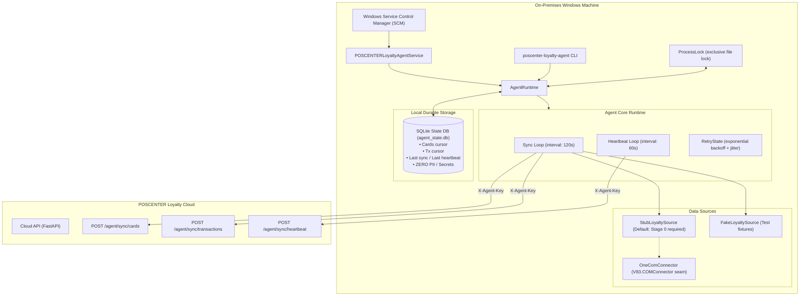

# POSCENTER Loyalty Windows Agent Architecture

## 1. Overview & Objective

The **POSCENTER Loyalty Windows Agent** (`poscenter-loyalty-agent`) is an on-premises synchronization service designed to run on the cashier workstation or back-office Windows machine running **POSCENTER ONE** (1C:Enterprise).

Its primary objective is **reliable, durable, at-least-once synchronization** of loyalty cards and bonus transactions from local POSCENTER ONE data stores to the central POSCENTER Loyalty Cloud API, with autonomous background health reporting.

---

## 2. High-Level Architecture Diagram



---

## 3. Core Principles & Guarantees

### 3.1 At-Least-Once Delivery & Crash Window Resilience
1. Data batches are fetched from the source with an opaque cursor (`cards_committed_cursor`, `transactions_committed_cursor`).
2. The agent sends the batch to Cloud API with `X-Agent-Key`.
3. **Crucial Rule:** The cursor is **ONLY** committed to local SQLite after a `2xx OK` ACK is received from the Cloud API.
4. If a process crash, power failure, or network drop occurs before or during transmission, the cursor remains at the previous committed position.
5. Upon restart, the agent safely re-fetches and re-transmits the batch. The Cloud Backend is idempotent:
   - Cards are matched by barcode; stale updates are ignored via timestamp comparison.
   - Transactions are deduplicated on `(card_id, external_id)`.

### 3.2 Opaque Cursors & Stalled Cursor Detection
- The agent runtime treats cursors as opaque strings (`str | None`) and never parses internal provider references.
- **Opaque Cursor Contract (TASK-009 requirement):**
  - Deterministic: identical position yields identical cursor.
  - Opaque: runtime treats it as an uninspected string token.
  - Zero PII: must never contain phone numbers, full names, or card barcodes.
  - Zero Credentials: must never contain passwords or infobase connection details.
  - Process-Independent: persists across restarts in SQLite.
- To prevent infinite loops caused by misbehaving sources:
  - If `batch.has_more is True` and `batch.next_cursor == current_cursor`: runtime raises `SOURCE_CURSOR_STALLED`.
  - If `len(batch.items) == 0` and `batch.has_more is True`: runtime raises `SOURCE_PROTOCOL_ERROR`.
  In both cases, cursor does not advance, Cloud call is skipped, and runtime backs off safely.

### 3.3 Zero Secrets & Zero PII in State Store & Logs
- The local SQLite database (`agent_state.db`) stores strictly operational metadata (`cards_committed_cursor`, `transactions_committed_cursor`, `last_successful_sync_at`, `last_heartbeat_at`, `last_error`, `last_error_at`).
- **Zero PII**: No customer names, phone numbers, or card barcodes are persisted in the checkpoint store.
- **Zero Secrets**: Entire `ONE_CONNECTION_STRING` is treated as a secret; never logged or revealed in exceptions.
- **Cursor Privacy**: Raw cursor values are never written to standard logs or CLI status output.

### 3.4 Page Budget per Stream
- `AGENT_MAX_PAGES_PER_CYCLE` limits pages processed per cycle independently for `cards` and `transactions`.
- If the cards stream exhausts its budget, the transactions stream still receives its full budget, preventing transaction starvation during large card backlogs.
- Reaching the page limit is a normal operational boundary, not an error.

### 3.5 Bounded Graceful Shutdown
- `AGENT_SHUTDOWN_GRACE_SECONDS` allows in-flight sync operations and cursor commits to finish cleanly before forcing task cancellation.

### 3.6 Stage 0 Discovery Requirement
- Real 1C metadata object and field names are **not hardcoded or guessed**.
- Production installations default to `ONE_ADAPTER_MODE=stub`, which safely raises `ONE_MAPPING_NOT_CONFIGURED` pointing to `docs/ONE_STAGE0_REQUIRED.md`.

---

## 4. Component Structure

| Module | Purpose |
|---|---|
| `config.py` | Pydantic-based configuration management (`AgentSettings`) with strict production validations (HTTPS, key length, adapter mode checks). |
| `logging.py` | Structured logger with rotating file handler (`RotatingFileHandler`) and secret/PII redaction filter. |
| `process_lock.py` | OS-level exclusive process lock (`AGENT_ALREADY_RUNNING`). |
| `models.py` | Pydantic domain models & DTOs strictly aligned with Cloud API schema (`CardSyncItem`, `TransactionSyncItem`, etc.) with timezone validation. |
| `state_store.py` | SQLite checkpoint repository with WAL mode, schema versioning (v1), corruption detection, and sanitized error recording. |
| `cloud_client.py` | Async HTTP client (`HttpCloudClient`) using `httpx` with timeout management, retryable/non-retryable error categorization, and malformed 2xx protection (`CloudProtocolError`). |
| `source.py` | `LoyaltySource` protocol with `StubLoyaltySource` (default) and `FakeLoyaltySource` (testing) and protocol violation handling (`SourceProtocolError`). |
| `one_com.py` | Guarded connection seam for `V83.COMConnector` with platform safety check and total connection string secrecy. |
| `retry.py` | Exponential backoff algorithm with configurable jitter ratio and capped `Retry-After` header support. |
| `runtime.py` | `AgentRuntime` managing sync cycle, stream page budgets, cursor progression, heartbeat loop, and bounded graceful shutdown. |
| `windows_service.py` | Cross-platform safe Windows Service wrapper (`win32serviceutil.ServiceFramework`). |
| `main.py` | CLI entrypoints (`run`, `check-config`, `status`, `service`). |

---

## 5. Configuration Reference

| Environment Variable | Default | Description |
|---|---|---|
| `AGENT_ENV` | `development` | Environment: `development`, `production`, `test` |
| `AGENT_CLOUD_BASE_URL` | `http://localhost:8000` | Cloud Backend URL (must be `https://` in production) |
| `AGENT_API_KEY` | `""` | Agent API secret (min 16 chars in production) |
| `AGENT_POLL_INTERVAL_SECONDS` | `120` | Interval between sync cycles (seconds) |
| `AGENT_HEARTBEAT_INTERVAL_SECONDS` | `60` | Interval between heartbeats (seconds) |
| `AGENT_HTTP_TIMEOUT_SECONDS` | `30.0` | Timeout for HTTP requests (seconds) |
| `AGENT_CARD_BATCH_SIZE` | `100` | Max cards per batch (backend limit: 500) |
| `AGENT_TX_BATCH_SIZE` | `200` | Max transactions per batch (backend limit: 1000) |
| `AGENT_MAX_PAGES_PER_CYCLE` | `10` | Max pages per sync cycle per stream |
| `AGENT_SYNC_BACKOFF_INITIAL_SECONDS` | `2.0` | Initial retry backoff delay (seconds) |
| `AGENT_SYNC_BACKOFF_MAX_SECONDS` | `300.0` | Maximum retry backoff delay (seconds) |
| `AGENT_SYNC_BACKOFF_JITTER_RATIO` | `0.2` | Random jitter ratio applied to backoff |
| `AGENT_SHUTDOWN_GRACE_SECONDS` | `30.0` | Grace period for active in-flight sync requests during shutdown |
| `AGENT_STATE_DB_PATH` | Platform default | Path to `agent_state.db` SQLite file |
| `AGENT_LOG_DIR` | Platform default | Directory for rotating log files |
| `ONE_ADAPTER_MODE` | `stub` | Mode: `stub`, `fake` (test only), `com` |
| `ONE_CONNECTION_STRING` | `""` | 1C COM connection string (entire string treated as secret) |
| `LOG_LEVEL` | `INFO` | Logging level (`DEBUG`, `INFO`, `WARNING`, `ERROR`) |

---

## 6. Execution & Deployment

### 6.1 Interactive Console Execution
```bash
poscenter-loyalty-agent run
```

### 6.2 Pre-flight Configuration Validation
```bash
poscenter-loyalty-agent check-config
```

### 6.3 Checking Sync Status & Checkpoints
```bash
poscenter-loyalty-agent status
```

### 6.4 Windows Service Installation & Management (Windows only)
```cmd
:: Install Windows Service
poscenter-loyalty-agent service install

:: Start Windows Service
poscenter-loyalty-agent service start

:: Stop Windows Service
poscenter-loyalty-agent service stop

:: Remove Windows Service
poscenter-loyalty-agent service remove
```
