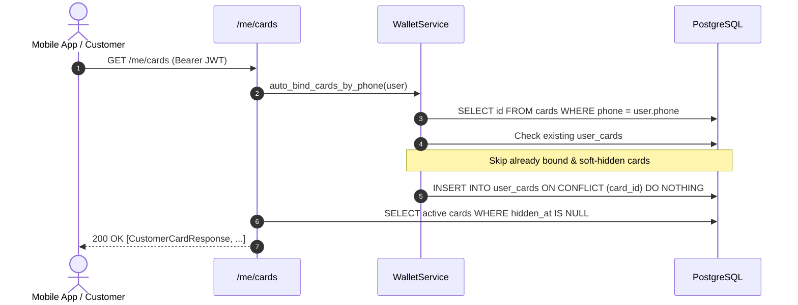

# Customer Wallet API Specification

## 1. Overview & Security Architecture

The Customer Wallet API provides mobile and web clients with authenticated access to customer loyalty cards, mirrored balance information, and transaction histories.

### Authentication & Token Validation
All endpoints under `/me/*` require HTTP Bearer authentication:

```http
Authorization: Bearer <access_token>
```

#### JWT Access Token Lifecycle & Verification
1. **Signature & Expiration**: Token must be signed by the cloud backend using `JWT_SIGNING_KEY` with algorithm `HS256` and must not be expired (`exp`).
2. **Claim Verification**:
   - `sub`: Customer UUID (`users.id`).
   - `sid`: Authentication Session UUID (`auth_sessions.id`).
   - `typ`: Strict string match `"access"`.
3. **Session Revocation & Staleness Check**:
   - The token's session ID (`sid`) is checked against `auth_sessions`.
   - If `auth_sessions.revoked_at IS NOT NULL` (e.g. after `/auth/logout`), the request is rejected with `401 SESSION_REVOKED`.
   - If `auth_sessions.expires_at <= utcnow()`, the request is rejected with `401 SESSION_EXPIRED`.
   - If `auth_sessions.user_id != sub`, the request is rejected with `401 INVALID_TOKEN`.
4. **User Status Check**:
   - The user account must exist and have `deleted_at IS NULL`, otherwise rejected with `401 USER_NOT_FOUND`.

---

## 2. Loyalty Card Discovery & Phone Auto-Binding

When a customer calls `GET /me/cards`, the backend automatically executes `auto_bind_cards_by_phone`:



### Auto-Binding Invariants
1. **Single Ownership (`uq_user_cards_card_id`)**: A loyalty card can belong to at most one customer at any given time. If a card is already bound to another user, auto-binding never overwrites or reassigns it.
2. **Hidden Card Preservation**: If a customer previously soft-hid a card (`hidden_at IS NOT NULL`), auto-binding will **never** unhide it automatically.
3. **Multi-Business Support**: All cards across all business tenants matching the customer's verified phone are discovered and bound.
4. **Concurrency Safety**: Implemented via PostgreSQL `ON CONFLICT (card_id) DO NOTHING`, completely avoiding race-condition `IntegrityError` or duplicate entries.
5. **PII Sanitization**: Auto-bind operational logs never log customer phone numbers, full names, user IDs, or access tokens.

---

## 3. Endpoints

### 3.1. List Customer Cards
**`GET /me/cards`**

Returns all active (non-hidden) loyalty cards belonging to the authenticated customer. Triggers auto-binding for newly mirrored cards matching the customer's phone number.

#### Response (200 OK)
```json
[
  {
    "id": "18f3a3f0-4567-4e89-8d12-654321fedcba",
    "barcode": "0123456789012",
    "balance": "1250.5000",
    "is_blocked": false,
    "bound_at": "2026-09-29T10:00:00Z",
    "updated_at": "2026-09-29T10:00:00Z",
    "bind_method": "phone_auto",
    "business": {
      "id": "a90bcf12-1111-4444-8888-000000000001",
      "name": "Magnum Cash & Carry",
      "branding": {
        "logo_url": "https://cdn.example.com/magnum-logo.png",
        "primary_color": "#E30613",
        "accent_color": "#FFD100"
      }
    }
  }
]
```

*Notes:*
- `balance` is strictly formatted as a 4-decimal numeric string (e.g. `"1250.5000"`), avoiding floating point precision artifacts.
- `barcode` is a 13-digit string preserving any leading zeros (e.g. `"0123456789012"`, EAN-13 compatible).
- `updated_at` reflects the latest mirror snapshot timestamp from POSCENTER ONE for this `Card`. Customer API is strictly read-only relative to the loyalty mirror: customer operations never alter `cards.updated_at`.

---

### 3.2. Get Single Card Detail
**`GET /me/cards/{card_id}`**

Retrieves details for a single active loyalty card owned by the customer.

#### Path Parameters
- `card_id` (UUID): ID of the card in the `cards` table.

#### IDOR & Ownership Isolation
- If `card_id` does not exist, belongs to another user, or has been soft-hidden by the user, the server uniformly returns `404 CARD_NOT_FOUND`. No information regarding foreign cards is leaked.

#### Response (200 OK)
```json
{
  "id": "18f3a3f0-4567-4e89-8d12-654321fedcba",
  "barcode": "0123456789012",
  "balance": "1250.5000",
  "is_blocked": false,
  "bound_at": "2026-09-29T10:00:00Z",
  "updated_at": "2026-09-29T10:00:00Z",
  "bind_method": "phone_auto",
  "business": {
    "id": "a90bcf12-1111-4444-8888-000000000001",
    "name": "Magnum Cash & Carry",
    "branding": {
      "logo_url": "https://cdn.example.com/magnum-logo.png",
      "primary_color": "#E30613",
      "accent_color": "#FFD100"
    }
  }
}
```

---

### 3.3. Soft-Hide Card from Wallet
**`DELETE /me/cards/{card_id}`**

Soft-hides a card from the customer's wallet view.

#### Semantics & Concurrency Safety
- Executed as an atomic database update: `UPDATE user_cards SET hidden_at = now() WHERE user_id = :uid AND card_id = :cid AND hidden_at IS NULL RETURNING id`.
- Concurrency-safe: Under concurrent DELETE requests for the same card, exactly one request receives `204 No Content` and all competing requests receive `404 CARD_NOT_FOUND` (0 x 500 errors).
- Does **NOT** delete the card from `cards`.
- Does **NOT** alter the mirror snapshot `cards.updated_at`, balance, or card blocked state.
- Updates `user_cards.hidden_at = utcnow()`.
- Subsequent `GET /me/cards` will omit this card.
- Subsequent `GET /me/cards/{card_id}` will return `404 CARD_NOT_FOUND`.
- Calling `DELETE` on an already hidden or unowned card returns `404 CARD_NOT_FOUND`.
- Soft-hidden cards are **never** resurrected by subsequent auto-bind queries.

#### Response (204 No Content)
Empty body.

---

### 3.4. Get Card Transaction History
**`GET /me/cards/{card_id}/transactions`**

Returns a deterministic cursor-paginated list of transactions mirrored from POSCENTER ONE for this loyalty card.

#### Query Parameters
| Parameter | Type | Required | Description | Default / Range |
|---|---|---|---|---|
| `limit` | integer | No | Maximum items per page | Default: `20`, Min: `1`, Max: `100` |
| `cursor` | string | No | Opaque base64 pagination cursor | Optional |
| `type` | string | No | Exact filtering by the canonical type received from ONE (e.g. `accrual`, `redemption`) | Optional |

#### Keyset Cursor Specification
- **Determinism**: Results are strictly ordered by `Transaction.occurred_at DESC, Transaction.id DESC`.
- **Composite Index**: Supported by database index `ix_transactions_card_id_occurred_at` on `(card_id, occurred_at)`.
- **Cursor Format**: Base64 URL-safe encoding of `f"{occurred_at.isoformat()}|{id}"`.
- Invalid cursor strings return `400 INVALID_CURSOR`.

#### Response (200 OK)
```json
{
  "items": [
    {
      "id": "c56a8d3b-9a88-4e12-b98a-112233445566",
      "external_id": "pos-tx-1002",
      "type": "accrual",
      "amount": "50.0000",
      "balance_after": "1250.5000",
      "occurred_at": "2026-09-29T10:15:00Z",
      "receipt_ref": "REC-9876",
      "store": "Store #4 Almaty"
    }
  ],
  "next_cursor": "MjAyNi0wOS0yOVQxMDoxNTowMCswMDowMHxjNTZhOGQzYi05YTg4LTRlMTItYjk4YS0xMTIyMzM0NDU1NjY=",
  "has_more": true
}
```

---

## 4. Error Responses

All error responses adhere to the standard POSCENTER Loyalty error envelope:

```json
{
  "error": {
    "code": "STRING_ERROR_CODE",
    "message": "Human readable error description"
  }
}
```

| HTTP Status | Error Code | Description |
|---|---|---|
| `401` | `UNAUTHORIZED` | `Authorization` header missing |
| `401` | `INVALID_AUTHORIZATION_HEADER` | Header format is not `Bearer <token>` |
| `401` | `TOKEN_EXPIRED` | JWT signature is expired |
| `401` | `INVALID_TOKEN` | Signature verification failed or claims corrupted |
| `401` | `SESSION_REVOKED` | Auth session was revoked (e.g. after logout) |
| `401` | `SESSION_EXPIRED` | Auth session has expired in database |
| `401` | `SESSION_NOT_FOUND` | Session ID in token does not exist |
| `401` | `USER_NOT_FOUND` | User account deactivated or deleted |
| `400` | `INVALID_CURSOR` | Pagination cursor format is corrupt |
| `404` | `CARD_NOT_FOUND` | Card not found or not owned by user (IDOR protected) |
| `422` | `VALIDATION_ERROR` | Request validation error (e.g. invalid UUID format) |
