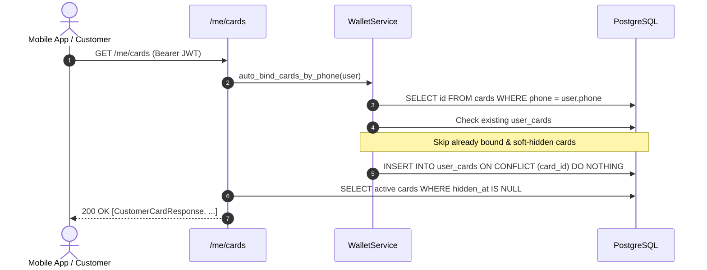

# Customer Wallet API Specification

## 1. Overview & Security Architecture

The Customer Wallet API provides mobile and web clients with authenticated access to customer loyalty cards, mirrored balance information, and transaction histories.

### Authentication & Token Validation
All endpoints under `/me/*` require HTTP Bearer authentication:

```http
Authorization: Bearer <access_token>
```

#### JWT Access Token Lifecycle & Verification
1. **Signature & Expiration**: Token must be signed by the cloud backend using `JWT_SIGNING_KEY` with algorithm `HS256` and must not be expired (`exp`).
2. **Claim Verification**:
   - `sub`: Customer UUID (`users.id`).
   - `sid`: Authentication Session UUID (`auth_sessions.id`).
   - `typ`: Strict string match `"access"`.
3. **Session Revocation & Staleness Check**:
   - The token's session ID (`sid`) is checked against `auth_sessions`.
   - If `auth_sessions.revoked_at IS NOT NULL` (e.g. after `/auth/logout`), the request is rejected with `401 SESSION_REVOKED`.
   - If `auth_sessions.expires_at <= utcnow()`, the request is rejected with `401 SESSION_EXPIRED`.
   - If `auth_sessions.user_id != sub`, the request is rejected with `401 INVALID_TOKEN`.
4. **User Status Check**:
   - The user account must exist and have `deleted_at IS NULL`, otherwise rejected with `401 USER_NOT_FOUND`.

---

## 2. Loyalty Card Discovery & Phone Auto-Binding

When a customer calls `GET /me/cards`, the backend automatically executes `auto_bind_cards_by_phone`:



### Auto-Binding Invariants
1. **Single Ownership (`uq_user_cards_card_id`)**: A loyalty card can belong to at most one customer at any given time. If a card is already bound to another user, auto-binding never overwrites or reassigns it.
2. **Hidden Card Preservation**: If a customer previously soft-hid a card (`hidden_at IS NOT NULL`), auto-binding will **never** unhide it automatically.
3. **Multi-Business Support**: All cards across all business tenants matching the customer's verified phone are discovered and bound.
4. **Concurrency Safety**: Implemented via PostgreSQL `ON CONFLICT (card_id) DO NOTHING`, completely avoiding race-condition `IntegrityError` or duplicate entries.
5. **PII Sanitization**: Auto-bind operational logs never log customer phone numbers, full names, user IDs, or access tokens.

---

## 3. Endpoints

### 3.1. List Customer Cards
**`GET /me/cards`**

Returns all active (non-hidden) loyalty cards belonging to the authenticated customer. Triggers auto-binding for newly mirrored cards matching the customer's phone number.

#### Response (200 OK)
```json
[
  {
    "id": "18f3a3f0-4567-4e89-8d12-654321fedcba",
    "barcode": "0123456789012",
    "balance": "1250.5000",
    "is_blocked": false,
    "bound_at": "2026-09-29T10:00:00Z",
    "updated_at": "2026-09-29T10:00:00Z",
    "bind_method": "phone_auto",
    "business": {
      "id": "a90bcf12-1111-4444-8888-000000000001",
      "name": "Magnum Cash & Carry",
      "branding": {
        "logo_url": "https://cdn.example.com/magnum-logo.png",
        "primary_color": "#E30613",
        "accent_color": "#FFD100"
      }
    }
  }
]
```

*Notes:*
- `balance` is strictly formatted as a 4-decimal numeric string (e.g. `"1250.5000"`), avoiding floating point precision artifacts.
- `barcode` is a 6 to 15 digit string preserving any leading zeros (e.g. `"012345"`, `"0123456789012"`).
- `updated_at` reflects the latest mirror snapshot timestamp from POSCENTER ONE for this `Card`. Customer API is strictly read-only relative to the loyalty mirror: customer operations never alter `cards.updated_at`.

---

### 3.2. Get Single Card Detail
**`GET /me/cards/{card_id}`**

Retrieves details for a single active loyalty card owned by the customer.

#### Path Parameters
- `card_id` (UUID): ID of the card in the `cards` table.

#### IDOR & Ownership Isolation
- If `card_id` does not exist, belongs to another user, or has been soft-hidden by the user, the server uniformly returns `404 CARD_NOT_FOUND`. No information regarding foreign cards is leaked.

#### Response (200 OK)
```json
{
  "id": "18f3a3f0-4567-4e89-8d12-654321fedcba",
  "barcode": "0123456789012",
  "balance": "1250.5000",
  "is_blocked": false,
  "bound_at": "2026-09-29T10:00:00Z",
  "updated_at": "2026-09-29T10:00:00Z",
  "bind_method": "phone_auto",
  "business": {
    "id": "a90bcf12-1111-4444-8888-000000000001",
    "name": "Magnum Cash & Carry",
    "branding": {
      "logo_url": "https://cdn.example.com/magnum-logo.png",
      "primary_color": "#E30613",
      "accent_color": "#FFD100"
    }
  }
}
```

---

### 3.3. Manual Card Binding (Barcode / QR)
**`POST /me/cards/bind`**

Binds an existing loyalty card mirrored from POSCENTER ONE to the authenticated customer using a 6 to 15 digit barcode or scanned QR code.

> **QR Scanner Architecture**: QR scanning is performed by the mobile client. Backend receives the decoded barcode (6 to 15 digits).
>
> **Activation Requirement**: Cashier/activation-code verification for cards without a phone is not implemented yet.

#### Request Body
```json
{
  "barcode": "0123456789012",
  "business_id": null
}
```

| Field | Type | Required | Description |
|---|---|---|---|
| `barcode` | string | Yes | 6 to 15 digit string (`^\d{6,15}$`), preserves leading zeros. |
| `business_id` | UUID | No | Optional tenant business ID to disambiguate identical barcodes across retailers. |

#### Business & Prefix Resolution
1. Searches existing mirror `cards` in active businesses (`status == "active"`).
2. If `business_id` is provided, matches `(business_id, barcode)`. Returns `404 CARD_NOT_FOUND` if not found or business is inactive.
3. If `business_id` is omitted:
   - If exactly 1 candidate card is found across active businesses, uses it.
   - If multiple candidate cards are found, applies `business.barcode_prefixes` matching (`barcode.startswith(prefix)`).
   - If prefix resolution yields exactly 1 business, uses it.
   - If prefix resolution is ambiguous or yields no match, returns `409 BUSINESS_SELECTION_REQUIRED` with candidate businesses. The mobile app prompts the user to select the retailer and re-invokes with `business_id`.

#### Phone Ownership Verification
- If `card.phone IS NULL`: returns `409 CARD_ACTIVATION_REQUIRED`.
- If `card.phone` is malformed: returns `409 CARD_BIND_NOT_ALLOWED`.
- If `normalize(card.phone) != current_user.phone`: returns `409 CARD_BIND_NOT_ALLOWED`.
- Customer personal data (phones, balances, names) is never leaked in errors or logs.

#### Existing Ownership & Manual Unhide
- **Already bound and visible**: Idempotent request; returns existing card representation (200 OK).
- **Already bound and soft-hidden**: Explicit re-add; sets `hidden_at = NULL` while preserving initial `bound_at` and `bind_method` (200 OK).
- **Bound to another user**: Returns `409 CARD_BIND_NOT_ALLOWED` without reassigning ownership.

#### Blocked Cards
- If `card.is_blocked == true`, linking succeeds if phone matches; returned representation reflects `"is_blocked": true`.

#### Response (200 OK)
Returns the standard `CustomerCardResponse` (same representation as `GET /me/cards/{id}`):
```json
{
  "id": "18f3a3f0-4567-4e89-8d12-654321fedcba",
  "barcode": "0123456789012",
  "balance": "1250.5000",
  "is_blocked": false,
  "bound_at": "2026-09-29T10:00:00Z",
  "updated_at": "2026-09-29T10:00:00Z",
  "bind_method": "manual_barcode",
  "business": {
    "id": "a90bcf12-1111-4444-8888-000000000001",
    "name": "Magnum Cash & Carry",
    "branding": {
      "logo_url": "https://cdn.example.com/magnum-logo.png",
      "primary_color": "#E30613",
      "accent_color": "#FFD100"
    }
  }
}
```

---

### 3.4. Soft-Hide Card from Wallet
**`DELETE /me/cards/{card_id}`**

Soft-hides a card from the customer's wallet view.

#### Semantics & Concurrency Safety
- Executed as an atomic database update: `UPDATE user_cards SET hidden_at = now() WHERE user_id = :uid AND card_id = :cid AND hidden_at IS NULL RETURNING id`.
- Concurrency-safe: Under concurrent DELETE requests for the same card, exactly one request receives `204 No Content` and all competing requests receive `404 CARD_NOT_FOUND` (0 x 500 errors).
- Does **NOT** delete the card from `cards`.
- Does **NOT** alter the mirror snapshot `cards.updated_at`, balance, or card blocked state.
- Updates `user_cards.hidden_at = utcnow()`.
- Subsequent `GET /me/cards` will omit this card.
- Subsequent `GET /me/cards/{card_id}` will return `404 CARD_NOT_FOUND`.
- Calling `DELETE` on an already hidden or unowned card returns `404 CARD_NOT_FOUND`.
- Soft-hidden cards are **never** resurrected by subsequent auto-bind queries.

#### Response (204 No Content)
Empty body.

---

### 3.5. Get Card Transaction History
**`GET /me/cards/{card_id}/transactions`**

Returns a deterministic cursor-paginated list of transactions mirrored from POSCENTER ONE for this loyalty card.

#### Query Parameters
| Parameter | Type | Required | Description | Default / Range |
|---|---|---|---|---|
| `limit` | integer | No | Maximum items per page | Default: `20`, Min: `1`, Max: `100` |
| `cursor` | string | No | Opaque base64 pagination cursor | Optional |
| `type` | string | No | Exact filtering by the canonical type received from ONE (e.g. `accrual`, `redemption`) | Optional |

#### Keyset Cursor Specification
- **Determinism**: Results are strictly ordered by `Transaction.occurred_at DESC, Transaction.id DESC`.
- **Composite Index**: Supported by database index `ix_transactions_card_id_occurred_at` on `(card_id, occurred_at)`.
- **Cursor Format**: Base64 URL-safe encoding of `f"{occurred_at.isoformat()}|{id}"`.
- Invalid cursor strings return `400 INVALID_CURSOR`.

#### Response (200 OK)
```json
{
  "items": [
    {
      "id": "c56a8d3b-9a88-4e12-b98a-112233445566",
      "external_id": "pos-tx-1002",
      "type": "accrual",
      "amount": "50.0000",
      "balance_after": "1250.5000",
      "occurred_at": "2026-09-29T10:15:00Z",
      "receipt_ref": "REC-9876",
      "store": "Store #4 Almaty"
    }
  ],
  "next_cursor": "MjAyNi0wOS0yOVQxMDoxNTowMCswMDowMHxjNTZhOGQzYi05YTg4LTRlMTItYjk4YS0xMTIyMzM0NDU1NjY=",
  "has_more": true
}
```

---

### 3.6. Loyalty level on cards

`GET /me/cards` и `GET /me/cards/{id}` возвращают поле `tier` (или `null`, если у бизнеса не настроены уровни):

```json
"tier": {"level": 1, "name": "Базовый", "percent": "3.0000", "max_percent": "12.0000", "spend_total": "150000.0000",
         "next_level": 2, "next_threshold": "500000.0000", "remaining": "350000.0000"}
```

Уровни задаются в админке у бизнеса (`loyalty_tiers`), прогресс считается по `spend_total` карты из ONE.

`levels` содержит все уровни программы бизнеса по возрастанию порога (`level`, `name`, `threshold`, `percent`); по нему приложение рисует окно «Как повысить статус».

### 3.7. Dynamic QR — `GET /me/cards/{card_id}/qr`

Возвращает `{token, expires_at, ttl_seconds}`. Токен `C1` + 48 символов base32, подписан сервером, живёт `QR_TOKEN_TTL_SECONDS` (60 с). Приложение обновляет его каждые `ttl/2`. Номер карты в QR не содержится; касса получает его через `POST /agent/qr/resolve`.

### 3.8. Profile — `GET /me/profile`, `PATCH /me/profile`

Поля: `language` (`ru`/`kz`), `first_name`, `last_name`, `email`, `gender` (`male`/`female`), `city`, `address`, `birth_date` (`YYYY-MM-DD`), `iin` (12 цифр с контрольной суммой), `company`; `phone` только для чтения. PATCH частичный: переданный `null` или пустая строка очищает поле.

### 3.9. Promotions, notifications, badges

* `GET /me/promotions` → `{banners, offers, has_new}`; видны активные акции в окне показа, общие и бизнесов, где у клиента есть карта. `GET /me/promotions/{id}`. `POST /me/promotions/seen` (204) снимает признак «новое».
* `GET /me/notifications` → `{items, unread_count}` (последние 100; рассылки до регистрации клиента не показываются). `POST /me/notifications/read` (204).
* `GET /me/badges` → `{promotions_new, notifications_unread}` для значков на вкладках.
* Свежие (до 24 часов) начисления и списания из синхронизации автоматически создают личное уведомление владельцу карты.

### 3.10. Phone Wallet Passes («Add to Wallet»)

Позволяет добавить карту в Apple Wallet (iOS) или Google Wallet (Android). В отличие от динамического QR внутри приложения, на Wallet-карте отображается **статичный штрихкод** (`card.barcode`) в виде QR, который кассир может отсканировать прямо с заблокированного телефона. Числовой баланс и статус на карте не отображаются (карта Wallet не синхронизируется при каждой покупке), а на обороте указано, что актуальный баланс доступен в приложении Cashback One, и что списание баллов подтверждается WhatsApp-кодом.

#### Проверка доступности кошельков
**`GET /me/wallet`** (Bearer JWT)

Возвращает флаги включения сервисов кошельков на текущем сервере:
```json
{
  "apple": true,
  "google": true
}
```

#### Запрос ссылки на добавление
**`POST /me/cards/{card_id}/wallet`** (Bearer JWT)

Тело запроса:
```json
{
  "platform": "apple"
}
```
(`"apple"` или `"google"`)

Успешный ответ (200 OK):
```json
{
  "url": "https://api.cashback-qr.poscenter.kz/wallet/apple/W1AA...4Z.pkpass",
  "expires_at": "2026-10-17T01:30:00Z"
}
```
Для `"google"` поле `url` ведёт на `https://pay.google.com/gp/v/save/<JWT>`, а `expires_at` равно `null`.
Если сервис не настроен, возвращается `503 WALLET_UNAVAILABLE`. Если карта заблокирована, возвращается `409 CARD_BLOCKED`.

### 3.11. Публичные эндпоинты кошельков

* **`GET /wallet/apple/{token}.pkpass`**: скачивание подписанного архива `.pkpass` для Apple Wallet без заголовка авторизации по одноразовому HMAC-токену `W1...`. Возвращает `Content-Type: application/vnd.apple.pkpass` и `Cache-Control: no-store`. Если ссылка недействительна или карта заблокирована — `404 WALLET_LINK_INVALID`.
* **`GET /wallet/assets/google-logo.png`**: публичный логотип сервиса в формате PNG для шаблонов Google Wallet. `Cache-Control: public, max-age=86400`.

## 4. Error Responses

All error responses adhere to the standard POSCENTER Loyalty error envelope:

```json
{
  "error": {
    "code": "STRING_ERROR_CODE",
    "message": "Human readable error description"
  }
}
```

| HTTP Status | Error Code | Description |
|---|---|---|
| `401` | `UNAUTHORIZED` | `Authorization` header missing |
| `401` | `INVALID_AUTHORIZATION_HEADER` | Header format is not `Bearer <token>` |
| `401` | `TOKEN_EXPIRED` | JWT signature is expired |
| `401` | `INVALID_TOKEN` | Signature verification failed or claims corrupted |
| `401` | `SESSION_REVOKED` | Auth session was revoked (e.g. after logout) |
| `401` | `SESSION_EXPIRED` | Auth session has expired in database |
| `401` | `SESSION_NOT_FOUND` | Session ID in token does not exist |
| `401` | `USER_NOT_FOUND` | User account deactivated or deleted |
| `400` | `INVALID_CURSOR` | Pagination cursor format is corrupt |
| `404` | `CARD_NOT_FOUND` | Card not found, business inactive, or not owned by user (IDOR protected) |
| `404` | `WALLET_LINK_INVALID` | Apple Wallet download link is corrupt, expired, or card is blocked |
| `409` | `BUSINESS_SELECTION_REQUIRED` | Multiple businesses match barcode; user selection required |
| `409` | `CARD_ACTIVATION_REQUIRED` | Card has no phone in ONE; activation required |
| `409` | `CARD_BIND_NOT_ALLOWED` | Card phone does not match user or card is owned by another user |
| `409` | `CARD_BLOCKED` | Card is blocked; cannot be added to wallet |
| `503` | `WALLET_UNAVAILABLE` | Wallet service (Apple or Google) is not configured on this server |
| `422` | `VALIDATION_ERROR` | Request validation error (e.g. invalid barcode format or UUID) |
