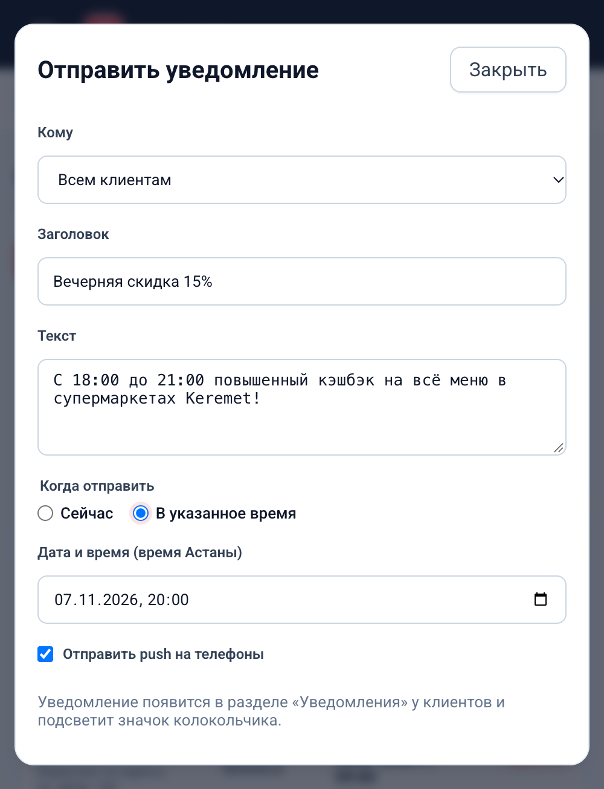
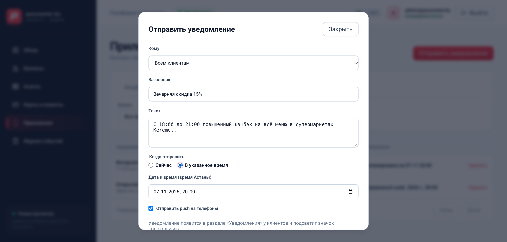

# Отчёт: push только в приложение магазина и отложенная отправка уведомлений

**Дата:** 2026-11-07  
**Исполнитель:** Gemini  
**Задача:** `docs/PROMPT_BACKEND_PUSH_OWN_APP_SCHEDULE_2026-11-07.md`  
**Репозиторий:** `/Users/nuras/Desktop/cashback-one` (`backend/` и `admin/`)

---

## 1. Новое правило адресатов push-уведомлений

По решению владельца от 2026-11-07:
1. Если у бизнеса задан `android_app_id`, его push уходят **только** в его приложение (`device.app_id == business.android_app_id`). В общее Cashback One (`push_shared_app_id`, по умолчанию `kz.cashbackone.mobile`) push этого бизнеса **не идут**.
2. В общее Cashback One push бизнеса уходят только тогда, когда у бизнеса `android_app_id IS NULL` (устройства владельцев карт этого бизнеса с общим приложением).
3. При рассылке на «Все бизнесы» (`business_id IS NULL`) — push уходит всем активным устройствам всех приложений без фильтрации.
4. Правило единообразно применяется ко всем сценариям:
   - Рассылки из кабинета администратора (`admin_content.create_notification`);
   - Запросы списания POS `/pos/redemptions`;
   - Push кода подтверждения `/pos/code-push`;
   - Проверка наличия приложения у покупателя (`has_active_device` в `app/services/push_service.py`): если у покупателя нет активного устройства **нужного** приложения, касса получает HTTP 409 с кодом `CUSTOMER_NO_APP`.

### Сводная таблица правил адресации

| Тип операции / источник | `business.android_app_id` задан (например, `kz.cashbackone.keremet`) | `business.android_app_id IS NULL` (нет своего приложения) | `business_id IS NULL` («Все бизнесы» / глобальные) |
|---|---|---|---|
| **Рассылка из кабинета** (`POST /admin/notifications`) | Только устройства с `app_id == business.android_app_id` | Только устройства общего приложения (`kz.cashbackone.mobile`) у владельцев карт бизнеса | Все активные устройства всех приложений |
| **Списание POS** (`POST /pos/redemptions`) | Push-код уходит только в приложение бизнеса | Push-код уходит в общее приложение владельца карты | — (всегда привязан к бизнесу кассы) |
| **Код на кассе** (`POST /pos/code-push`) | Push-код уходит только в приложение бизнеса | Push-код уходит в общее приложение владельца карты | — (всегда привязан к бизнесу кассы) |
| **Проверка `has_active_device`** | `True` только если есть устройство с `app_id == business.android_app_id` (иначе 409 `CUSTOMER_NO_APP`) | `True` если есть устройство общего приложения | `True` если есть активное устройство любого приложения |

Документация `docs/POS_REDEEM_API.md` обновлена с пояснением значения ошибки `CUSTOMER_NO_APP`.

---

## 2. Миграция базы данных (Alembic 0017)

Создана миграция `backend/migrations/versions/0017_scheduled_notifications.py`:
- **Ревизия:** `0017_scheduled_notifications`
- **Down revision:** `0016_business_android_app_id`
- **Изменения в таблице `notifications`:**
  - `scheduled_at` (`TIMESTAMPTZ` / `DateTime(timezone=True)`, `nullable=True`): плановое время отправки (NULL — немедленная отправка при создании);
  - `push_sent_at` (`TIMESTAMPTZ` / `DateTime(timezone=True)`, `nullable=True`): фактическое время отправки push фоновым воркером;
  - Составной индекс `ix_notifications_scheduled_pending` на `(scheduled_at, push_sent_at)` для эффективной выборки фоновым воркером.
- **Откат (downgrade):** удаление индекса `ix_notifications_scheduled_pending` и удаление колонок `scheduled_at` и `push_sent_at`.

Проверка миграции:
- SQLite (в памяти): апгрейд и даунгрейд протестированы в `test_migration_0017_upgrade_and_downgrade_sqlite` — PASSED.
- PostgreSQL: апгрейд и даунгрейд протестированы на базе `cashback_migration_check` в `test_migration_0017_postgres` — PASSED.

---

## 3. Фоновая отправка уведомлений (Scheduler Worker)

Реализован сервис `backend/app/services/notification_scheduler.py`:

1. **Атомарный захват записи:**
   ```python
   stmt = (
       select(Notification)
       .where(
           Notification.scheduled_at.is_not(None),
           Notification.scheduled_at <= now,
           Notification.push_sent_at.is_(None),
       )
       .order_by(Notification.scheduled_at.asc())
       .limit(1)
       .with_for_update(skip_locked=True)
   )
   ```
   Использование `with_for_update(skip_locked=True)` гарантирует, что даже при одновременной работе нескольких инстансов backend или перезапуске процесса ни одно отложенное уведомление не будет отправлено дважды.

2. **Отправка push и фиксация в единой транзакции:**
   После успешной отправки через `send_broadcast_push` поле `push_sent_at` выставляется в `utcnow()` и фиксируется (`session.commit()`).

3. **Скрытие от покупателей до наступления времени:**
   В `app/services/content_service.py` эндпоинты `/me/notifications` и счётчик непрочитанных колокольчика отфильтровывают записи условием:
   ```python
   or_(Notification.scheduled_at.is_(None), Notification.scheduled_at <= now)
   ```
   Покупатели не видят запланированное уведомление и не получают инкремент счётчика до наступления `scheduled_at`.

4. **Фоновый цикл:**
   Функция `run_scheduled_notifications_loop` запускается в фоновом таске при старте приложения FastAPI (`lifespan` в `app/main.py`), кроме тестового окружения (`app_env != "test"`). Интервал опроса по умолчанию — 30 секунд. Если найдена готовая к отправке запись, воркер обрабатывает её и сразу проверяет следующую.

---

## 4. Кабинет администратора (`admin/`)

1. **Диалог отправки уведомления (`ContentPage.tsx`):**
   - Добавлен блок переключателя **«Когда отправить»**:
     - «Сейчас» (по умолчанию);
     - «В указанное время».
   - При выборе «В указанное время» отображается поле выбора даты и времени (местное время Астаны, UTC+5).
   - Валидация времени: запрет времени в прошлом и запрет даты далее 30 дней вперед с понятными сообщениями об ошибке.
   - Кнопка действия динамически меняет текст: «Отправить» (для немедленных) или «Запланировать» (для отложенных).
2. **Таблица уведомлений:**
   - Отображаются статусы:
     - `Запланировано на DD.MM HH:mm` (для ожидающих отправки);
     - `Отправлено` (для уже отправленных);
   - Запланированное уведомление можно удалить до отправки кнопкой «Удалить» — фоновый воркер не отправит удалённое уведомление.
3. **Локализация:**
   - Все новые строки добавлены на русском и казахском языках в `admin/src/i18n/admin.ts`.

---

## 5. Снимки окна отправки уведомления

Снимки сделаны в браузере Chromium (DevTools):

1. **Мобильный экран (390 px):**  
   `reports/scheduled-push-2026-11-07/notification-schedule-dialog-ru-390.png` (142 731 байт)  
   

2. **Десктопный экран (1366 px):**  
   `reports/scheduled-push-2026-11-07/notification-schedule-dialog-ru-1366.png` (270 414 байт)  
   

---

## 6. Сырой вывод проверок

### 6.1. Полный прогон тестов backend (`pytest backend/tests -q`)
```
........................................................................ [ 13%]
........................................................................ [ 26%]
........................................................................ [ 40%]
........................................................................ [ 53%]
................s.s..................................................... [ 67%]
............ssssssssssssssssssssssssssssssssssss........................ [ 80%]
........................................................................ [ 94%]
..............................                                           [100%]
496 passed, 38 skipped, 4 warnings in 84.30s (0:01:24)
```

### 6.2. Тест миграции на PostgreSQL (`test_migration_0017.py`)
```
============================= test session starts ==============================
backend/tests/test_migration_0017.py::test_migration_0017_upgrade_and_downgrade_sqlite PASSED [ 50%]
backend/tests/test_migration_0017.py::test_migration_0017_postgres PASSED [100%]

============================== 2 passed in 0.66s ===============================
```

### 6.3. Линтер backend (`ruff check`)
```
backend/.venv/bin/ruff check backend/app backend/tests/test_scheduled_notifications.py backend/tests/test_migration_0017.py
All checks passed!
```

### 6.4. Проверка типов backend (`mypy backend/app`)
```
backend/.venv/bin/mypy backend/app
backend/app/services/media_storage.py:137: error: Exception type must be derived from BaseException (or be a tuple of exception classes)  [misc]
backend/app/services/media_storage.py:143: error: Exception type must be derived from BaseException (or be a tuple of exception classes)  [misc]
backend/app/services/media_storage.py:155: error: Exception type must be derived from BaseException (or be a tuple of exception classes)  [misc]
backend/app/services/media_storage.py:159: error: Exception type must be derived from BaseException (or be a tuple of exception classes)  [misc]
backend/app/services/media_storage.py:164: error: Exception type must be derived from BaseException (or be a tuple of exception classes)  [misc]
backend/app/services/media_storage.py:186: error: Exception type must be derived from BaseException (or be a tuple of exception classes)  [misc]
backend/app/services/media_storage.py:188: error: Exception type must be derived from BaseException (or be a tuple of exception classes)  [misc]
backend/app/services/media_storage.py:193: error: Exception type must be derived from BaseException (or be a tuple of exception classes)  [misc]
backend/app/services/media_storage.py:261: error: Exception type must be derived from BaseException (or be a tuple of exception classes)  [misc]
backend/app/services/image_service.py:101: error: Incompatible types in assignment (expression has type "Image", variable has type "ImageFile")  [assignment]
backend/app/services/image_service.py:112: error: Incompatible types in assignment (expression has type "Image", variable has type "ImageFile")  [assignment]
backend/app/services/image_service.py:114: error: Incompatible types in assignment (expression has type "Image", variable has type "ImageFile")  [assignment]
backend/app/services/image_service.py:122: error: Incompatible types in assignment (expression has type "Image", variable has type "ImageFile")  [assignment]
backend/app/services/image_service.py:124: error: Incompatible types in assignment (expression has type "Image", variable has type "ImageFile")  [assignment]
Found 14 errors in 2 files (checked 69 source files)
```
*(В новых и изменённых файлах ошибок нет; 14 известных давних ошибок только в `media_storage.py` и `image_service.py`)*

### 6.5. Тесты кабинета Vitest (`npx vitest run --maxWorkers=1`)
```
 Test Files  22 passed (22)
      Tests  184 passed (184)
   Start at  17:41:28
   Duration  66.53s (transform 1.08s, setup 5.14s, import 3.72s, tests 31.03s, environment 20.55s)
```

### 6.6. Typecheck, Lint и Build кабинета (`admin/`)
```
> cashback-one-admin@1.0.0 typecheck
> tsc --noEmit

> cashback-one-admin@1.0.0 lint
> eslint .

> cashback-one-admin@1.0.0 build
> tsc --noEmit && vite build

vite v8.3.2 building client environment for production...
✓ 115 modules transformed.
dist/index.html                                              3.09 kB │ gzip:  1.28 kB
dist/assets/index-rT6CoaAM.css                              47.24 kB │ gzip:  9.70 kB
dist/assets/AdminRoutes-B78MjYCy.js                        204.39 kB │ gzip: 49.99 kB
dist/assets/index-B5Xqy4Fs.js                              305.28 kB │ gzip: 94.27 kB
✓ built in 818ms
```

### 6.7. Git diff проверки
```
$ git diff --stat
 admin/src/api/types.ts                  |  2 +
 admin/src/i18n/admin.ts                 | 20 +++++++
 admin/src/pages/ContentPage.tsx         | 99 ++++++++++++++++++++++++++++++++-
 admin/src/utils/format.ts               | 45 +++++++++++++++
 backend/app/main.py                     | 15 ++++-
 backend/app/models/entities.py          |  7 +++
 backend/app/schemas/admin_content.py    | 23 +++++++-
 backend/app/services/admin_content.py   | 63 ++++++++++++++-------
 backend/app/services/content_service.py | 32 ++++++++---
 backend/app/services/pos_service.py     |  6 +-
 backend/app/services/push_service.py    | 53 ++++++++---------
 backend/tests/test_broadcast_push.py    |  7 ++-
 backend/tests/test_push_per_client.py   | 25 +++++++--
 docs/POS_REDEEM_API.md                  |  4 +-
 14 files changed, 331 insertions(+), 67 deletions(-)

$ git diff --check
(вывод пустой, пробельных ошибок и конфликтов нет)
```

---

## 7. Ограничения

- Production сервер не затрагивался;
- Деплой не производился;
- Мобильное приложение и агент не модифицировались;
- Commit/push в git не выполнялись.

---

## 8. Доработка кабинета (2026-11-07)

По задаче `docs/PROMPT_ADMIN_SCHEDULE_FIX_2026-11-07.md` выполнены следующие доработки в `admin/`:

### 8.1. Что изменено
1. **Статус в таблице уведомлений (`ContentPage.tsx`):**
   - Ранее для запланированных уведомлений без push сервер сразу выставлял `push_sent_at = scheduled_at`, из-за чего в таблице отображался статус «Отправлено» с датой из будущего.
   - Реализовано новое правило: если `scheduled_at` задан и он в будущем (`new Date(item.scheduled_at).getTime() > Date.now()`), всегда отображается статус `Запланировано на DD.MM HH:mm` (независимо от значения `push_sent_at`).
   - Если дата в прошлом или `scheduled_at` не задан, отображается статус `Отправлено` с временем `scheduled_at ?? created_at`.

2. **Фиксированный часовой пояс UTC+5 (`utils/format.ts`):**
   - Функция `formatAstanaSchedule` переведена с вызова `Intl.DateTimeFormat` с временной зоной `Asia/Almaty` на прямое вычисление по фиксированному смещению UTC+5 (+5 часов от UTC):
     ```typescript
     export function formatAstanaSchedule(value: string): string {
       const date = new Date(value);
       if (isNaN(date.getTime())) return '';
       const astanaMs = date.getTime() + 5 * 3600 * 1000;
       const d = new Date(astanaMs);
       const day = String(d.getUTCDate()).padStart(2, '0');
       const month = String(d.getUTCMonth() + 1).padStart(2, '0');
       const hour = String(d.getUTCHours()).padStart(2, '0');
       const minute = String(d.getUTCMinutes()).padStart(2, '0');
       return `${day}.${month} ${hour}:${minute}`;
     }
     ```
   - Это гарантирует идентичность ввода и отображения времени на любых клиентских ОС независимо от версии локальных баз часовых поясов.

3. **Оформление диалога и удаление inline-стилей (`admin.css`, `ContentPage.tsx`):**
   - Полностью удалены inline-стили у переключателя «Когда отправить», поля даты и чекбокса.
   - В `admin.css` добавлены классы `.mutation-fieldset`, `.mutation-radio-group`, `.mutation-radio-label`, `.mutation-checkbox-label`.
   - Поле даты и времени `<input id="note-scheduled">` и его метка `<label htmlFor="note-scheduled">` выведены прямыми потомками `.mutation-form` (через React fragment `<>`). Благодаря этому к подписи даты автоматически применился класс `.mutation-form > label` (шрифт Roboto, размер 12px, цвет `#334155`, полужирный `font-weight: 600`), визуально идентичный меткам «Заголовок» и «Текст».
   - К форме диалога добавлен атрибут `noValidate`, позволяющий единообразно валидировать форму на стороне React и выводить стилизованные сообщения об ошибках в `<p className="form-error" role="alert">{error}</p>`.

4. **Тесты кабинета (`admin/tests/scheduled-notifications.test.tsx`):**
   - Разработан отдельный тестовый набор из 6 тестов (общее количество тестов кабинета выросло с 184 до 190):
     - Переключение «Сейчас / В указанное время» и появление поля даты только в режиме планирования (RU и KK);
     - Валидация пустого времени, времени в прошлом и времени далее 30 дней вперед с проверкой, что API-запрос не отправляется;
     - Корректная конвертация местного времени Астаны в UTC ISO при отправке запроса (ввод `2026-11-07T18:00` отправляется как `2026-11-07T13:00:00.000Z`);
     - Проверка статусов в таблице: «Запланировано на …» для уведомлений с push и без push (когда `push_sent_at` заполнен сервером), а также «Отправлено» (RU и KK).

5. **Снимки настоящей страницы (`reports/scheduled-push-2026-11-07/`):**
   - Прежние снимки с временного HTML удалены и заменены снимками, снятыми из реального интерфейса кабинета, запущенного на Vite dev server с моками API.
   - На снимках одновременно виден открытый диалог «Отправить уведомление» в режиме «В указанное время» (с заголовком, текстом, датой, кнопкой «Запланировать») и фоновая таблица со статусами «Запланировано на 07.11 20:00» и «Отправлено».
   - Файлы сохранены:
     - `reports/scheduled-push-2026-11-07/notification-schedule-dialog-ru-1366.png` (410 855 байт, 1366×768)
     - `reports/scheduled-push-2026-11-07/notification-schedule-dialog-ru-390.png` (149 021 байт, 390×844)

### 8.2. Сырой вывод проверок

#### Vitest (`cd admin && npx vitest run --maxWorkers=1`)
```
 Test Files  23 passed (23)
      Tests  190 passed (190)
   Start at  18:32:06
   Duration  73.23s (transform 1.49s, setup 6.24s, import 3.88s, tests 34.06s, environment 22.06s)
```

#### Typecheck, Lint и Build (`cd admin && npm run typecheck && npm run lint && npm run build`)
```
> cashback-one-admin@1.0.0 typecheck
> tsc --noEmit

> cashback-one-admin@1.0.0 lint
> eslint .

> cashback-one-admin@1.0.0 build
> tsc --noEmit && vite build

vite v8.3.2 building client environment for production...
✓ 115 modules transformed.
dist/index.html                                              3.09 kB │ gzip:  1.29 kB
dist/assets/index-DaKWmSqK.css                              47.87 kB │ gzip:  9.80 kB
dist/assets/AdminRoutes-DOTT_YlV.js                        203.97 kB │ gzip: 49.82 kB
dist/assets/index-BkKG86U_.js                              305.28 kB │ gzip: 94.27 kB

✓ built in 581ms
```

#### Git diff по кабинету (`git diff --stat -- admin`)
```
 admin/src/api/types.ts          |  2 +
 admin/src/i18n/admin.ts         | 20 +++++++++
 admin/src/pages/ContentPage.tsx | 97 ++++++++++++++++++++++++++++++++++++++---
 admin/src/styles/admin.css      | 52 ++++++++++++++++++++++
 admin/src/utils/format.ts       | 39 +++++++++++++++++
 5 files changed, 204 insertions(+), 6 deletions(-)
```

#### Проверка пробелов и конфликтов (`git diff --check`)
```
(вывод пустой, ошибок нет)
```

